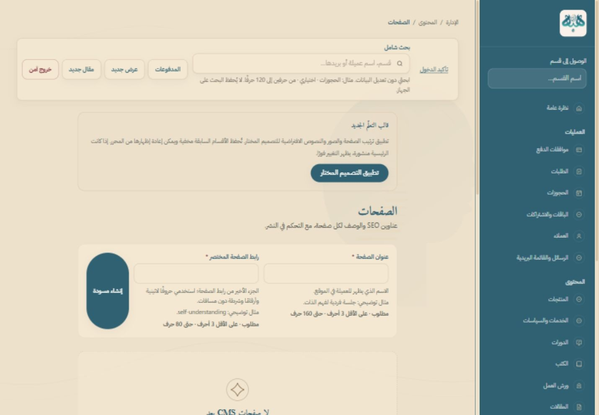

# تقرير تسليم الحالة الحالية للوحة إدارة هبة الشريف

تاريخ المراجعة: 17 أكتوبر 2026، توقيت القاهرة. نطاق العمل: جمع أدلة وقراءة الملفات وقاعدة الإنتاج والواجهة المنشورة، دون تطوير أو نشر أو تغيير محتوى أو تنفيذ معاملات جديدة. هذا التقرير يصف لقطة زمنية؛ قد تتغير الحجوزات والجلسات بفعل المستخدمين والعامل المجدول أثناء المراجعة.

## 1. خلاصة الحالة وطريقة قراءة الأدلة

الموقع المنشور متصل بالمحتوى الفعلي، ودخول المالكة يعمل حاليًا. فتحت المراجعة الحالية جميع أقسام التنقل الثلاثين في الإدارة، وفتحت محررات الجلسة والكورس والدرس وملفات الكتاب دون حفظ، وأعادت تحميل لوحة التحكم مع بقاء الجلسة. هذا يثبت القراءة والتنقل والجلسة في هذه البيئة، ولا يثبت جميع عمليات الإضافة والحذف والدفع.

أكبر الفجوات الحالية: إدارة الرئيسية غير مهيأة بصفحة وأقسام محفوظة في قاعدة الإنتاج؛ وسائل التحصيل والسياسات النهائية غير معتمدة؛ لا يوجد قبول حي كامل لمسار مالي مدفوع أو لفريق بأدوار متعددة. توجد أيضًا مخاطرة اتساق في استعادة مراجعات المحتوى، وحدود قوائم غير موحدة، وتفاصيل استخدام تحتاج تبسيطًا.

### تصنيف الحالة

| الرمز | المعنى | حدود الاستنتاج |
|---|---|---|
| **أ** | موجود ويعمل وتم اختباره | يذكر التقرير العملية ونوع الاختبار وتاريخه؛ نجاح العرض لا يمتد تلقائيًا إلى الحفظ |
| **ب** | موجود ولم يُختبر عمليًا بالقدر المطلوب | المسار يصل إلى تنفيذ خلفي، لكن لا يوجد قبول حي للعملية المحددة |
| **ج** | موجود جزئيًا أو به عطل/قيد فعلي | يذكر القيد ودليله، ويفصل المخاطرة المستنتجة من عطل أُعيد إنتاجه |
| **د** | غير موجود حاليًا أو اقتراح | لا يُقدَّم كميزة متاحة للمالكة أو العميلة |

الأدلة الجديدة القابلة للمشاركة محفوظة في [مجلد الأدلة](admin-current-state-evidence/README.md): [قاعدة البيانات والإصدار](admin-current-state-evidence/database-and-release.json)، [سجل النشر المنقح](admin-current-state-evidence/deployments.json)، [قراءة الواجهات الحالية](admin-current-state-evidence/ui-current.json)، [الاختبارات](admin-current-state-evidence/test-summary.json)، [فهرس الصور](admin-current-state-evidence/images.json). لا تتضمن هذه الملفات كلمات مرور أو مفاتيح أو صفوف عميلات أو محتويات البيئة.

الأدلة التاريخية المحلية في `.launch-backups/` لم تُنسخ بالجملة لأنها قد تحتوي نسخ قاعدة وسجلات خاصة. استُخدمت ملخصاتها المحددة أدناه مع [وثيقة الاختبارات](TESTING.md) و[سجل الحالة](PROJECT_STATE.md). الفقرات الأقدم في سجل الحالة التي تقول إن الجلسات مخفية أو إن الحجز غير متاح تجاوزتها النسخة الحالية.

## 2. تحديد النسخة والبيانات الفعلية

| البند | النتيجة المثبتة |
|---|---|
| الجذر الفعلي | `D:\New life\Heba\web\Hebaelsherif-GitHub`؛ أكده `git rev-parse --show-toplevel` |
| GitHub | [ahmedmg0maa/Hebaelsherif](https://github.com/ahmedmg0maa/Hebaelsherif)، remote باسم `origin` |
| الفرع | `prepare-cream-motion` |
| آخر commit | `c56372482eff9845863a98fe06721a48c20f24c8`، 17 أكتوبر 2026، 12:22:44 القاهرة؛ `Record published client acceptance and clarify free access steps` |
| حالة الرفع | `git ls-remote origin refs/heads/prepare-cream-motion` أعاد SHA نفسه؛ لا يوجد commit محلي معلق فوق نسخة الفرع البعيدة وقت الفحص |
| العمل المحلي قبل المراجعة | `git status --short` كان فارغًا. ما تضيفه هذه المراجعة هو التقرير والأدلة وتحديث توثيقي لسجل الحالة فقط؛ لا تغييرات تطبيق/ترحيلات/اعتماديات |
| الدومينان | [hebaelsherif.com](https://hebaelsherif.com/) و[www](https://www.hebaelsherif.com/) يعيدان manifest يحمل SHA نفسه و`sourceDirty=false` |
| زمن البناء | `2026-10-17T09:24:04.014Z`، أي 12:24:04 القاهرة؛ هذا زمن البناء وليس وقت تحويل المرور |
| النشر الفعلي | Cloudflare Worker `heba-elsherif-platform`؛ deployment `ff7ef68a-54f8-4dcd-af90-90b31529d186` عند `2026-10-17T09:24:48.15309Z`، أي 12:24:48 القاهرة؛ مصدره Wrangler؛ 100% إلى version `98a3a5b5-11d2-4e45-9f5a-b453f8134bd5` |
| التطابق | نسخة الفرع البعيدة والمحلية وmanifest الدومينين متطابقة. صور هذه المراجعة مأخوذة من الإنتاج نفسه؛ لم يُنفذ نشر جديد لإعداد التقرير |
| قاعدة الإنتاج | Supabase `zfbwpubsnuijybxjuidc`؛ سجل الترحيلات 108 مدخلات من 000 إلى 107 |
| العقود | booking: customerJourney=093، coachCalendar=097، coachWorkingHours=103، customerRequests=107. launch: revision=102 وfreeOperations=102؛ رقم العقد ليس أعلى رقم ترحيل |
| القيود التشغيلية | الوضع المعتمد `production` مع `free`؛ لا تفعيل لخدمات مدفوعة في هذه المراجعة. أدوات الفيديو المدفوع ليست مطلوبة لتشغيل النصوص والملفات |

مصدر وقت النشر هو قراءة `wrangler deployments list`، لا وقت تعديل ملف محلي. مرجع الأمر: [وثائق Cloudflare الرسمية](https://developers.cloudflare.com/workers/wrangler/commands/). وإثبات الإصدار العام متاح في [manifest الإنتاج](https://hebaelsherif.com/.well-known/heba-release.json).

### لقطة قاعدة الإنتاج عند 13:04:08 القاهرة

| البيانات | الموجود فعليًا |
|---|---|
| المنتجات والخدمات | 4 منتجات؛ خدمتا جلسات منشورتان ومفعّلتان في وضع طلب موعد بسعر محدد |
| التعلم | كورس واحد، وحدة واحدة، 3 دروس؛ كتاب واحد وملف تسليم واحد؛ مقالان |
| جدول العمل | 7 سجلات أسبوعية عامة، و10 نوافذ خاصة بالخدمات، ولا استثناءات عامة مسجلة |
| الحجوزات | حجز واحد بحالة `cancelled`؛ hold واحد `converted`؛ صفر holds نشطة غير منتهية |
| البريد المرتبط بالحجز | 3 سجلات: 2 `sent` و1 `superseded`؛ الأخيرة رسالة تجاوزها تحديث أحدث، وليست بالضرورة فشل إرسال |
| الماليات | صفر orders/payments/payment_refunds؛ لا باقات اشتراك معرفة. عدم وجود orders الآن لا ينفي اختبار الطلب المجاني السابق الذي نُظفت بياناته |
| المحتوى غير المهيأ | صفر pages/page_sections، عروض، كوبونات، ورش، تقييمات، موارد، ظهور إعلامي، اختبارات إرشادية، رسائل تواصل |
| الوسائط | 3 أصول مسجلة |
| الهوية الإدارية | حساب Auth أصلي واحد، وتمكين واحد لدخول المالكة، وتعيين دور owner واحد. أعداد جلسات الإدارة تشمل التاريخ ولا تعني مستخدمات إضافيات |

قراءة المخطط لم تكتفِ بوجود الدوال: طابقت أجسام 14 دالة حساسة مع آخر تعريف محلي بعد توحيد نهايات الأسطر وإزالة الفراغ الخارجي فقط. كلها متطابقة، ومن بينها `get_admin_security_readiness` من 096، و`complete_booking_hold_v2` من 107، و`admin_update_booking_governed` من 061، وجدول هبة من 103، والتسجيل الذري للوسائط من 106. هذا فحص لتعريف الجسم والامتيازات المرفقة، وليس مقارنة شاملة لكل قيد وفهرس وسياسة في القاعدة.

### دخول المالكة

**أ — نجاح فعلي.** الفشل السابق كان رفض Supabase لكلمة المرور (`invalid_credentials`) قبل إنشاء جلسة أدمن. أتمت المالكة الاستعادة وتعيين كلمة المرور بنفسها، ثم أكدت الوصول إلى `/admin/overview`. لم تُلغَ MFA لباقي الفريق.

في المراجعة الحالية كانت جلسة المتصفح تحتاج دخولًا جديدًا؛ بعد إدخال المالكة بنفسها ظهرت `/admin/overview`، ثم نجح فتح الأقسام وإعادة تحميل اللوحة دون رجوع إلى الدخول. لم تُقرأ كلمة المرور ولم يُعتمد نجاح `check-admin-login` كبديل لهذا الاختبار.

الخروج الآمن وحماية اللوحة بعد الخروج اختُبرا سابقًا فعليًا على جلسة الاختبار، وأكدت القاعدة إبطال جلسة الإدارة وجلسة Auth المرتبطة. لم يُكرر الخروج في مراجعة القراءة الحالية كي لا تُنهى جلسة المالكة المستخدمة في التصوير. لا يوجد عطل دخول قائم أُعيد إنتاجه الآن؛ قبول MFA لحسابات فريق أخرى غير منفذ. رابط إعادة التأكيد للإجراءات الحساسة بعد عشر دقائق سلوك حماية مقصود.

## 3. خريطة جميع صفحات الإدارة

المصدر يحتوي **33 ملف page.tsx**: جذر تحويل، و30 قسمًا في القائمة، وصفحتين تفصيليتين للمنهج والعميلة. لا توجد صفحة مستقلة باسم `/admin/calendar` أو `/admin/home`: التقويم داخل الحجوزات وإدارة الرئيسية داخل الصفحات.

**قاعدة الجدول:** «متصل» تعني وجود واجهة → server action → RPC/قراءة قاعدة وصلاحية في المصدر. لا تعني أن كل زر جُرب. **أ/عرض** يعني أن الصفحة فُتحت حاليًا؛ يضاف الحفظ المختبر صراحة. الملفات المذكورة بجوار page هي الملفات الرئيسية المكملة وليست جميع الاعتماديات. مسار كل صفحة أدناه يقابل `src/app/admin/<المسار>/page.tsx`؛ الصفوف التفصيلية تستعمل `[id]` فعليًا.

أسماء المكونات المختصرة في العمود الأخير تقع تحت `src/components/admin/`، ومسارات `actions/` و`data/` و`auth/` و`catalog/` المختصرة تحت `src/lib/`. مثلًا `BookingAgenda.tsx` هو `src/components/admin/BookingAgenda.tsx`، و`actions/booking-admin.ts` هو `src/lib/actions/booking-admin.ts`.

| الصفحة والمسار | الغرض والبيانات | الإجراءات المتصلة فعلًا | الحالة وما ينقص/لا يعمل | الملفات الرئيسية المكملة |
|---|---|---|---|---|
| مدخل الإدارة `/admin` | تحويل إلى النظرة العامة | تحويل فقط | أ/مصدر؛ لا CRUD في الجذر | `src/app/admin/page.tsx`، `layout.tsx`، `src/lib/auth/admin.ts` |
| نظرة عامة `/admin/overview` | الإيرادات، حالات الحجز، الموافقات، أحدث العميلات، جدول اليوم، الجاهزية | روابط أقسام، إجراءات موافقة الدفعات عند وجودها | أ/عرض وتحديث جلسة؛ الماليات صفر، المخططات ليست اختبار محاسبة | `Charts.tsx`، `ApprovalActions.tsx`، `src/lib/data/admin.ts` |
| الحجوزات `/admin/bookings` | حجوزات فترة القاهرة، الاسم عبر قراءة profiles منفصلة، الأحداث وطلبات النقل والسعر المطلوب | يوم/أسبوع/شهر/قائمة، السابق/التالي، بحث وحالة، إدارة الموعد والحالة والرابط والملاحظات، قبول/رفض النقل؛ لا حذف سجل حجز | أ/عرض وتنقل؛ تأكيد الطلب والإلغاء اختبرا SQL سابقًا، لا اختبار يدوي كامل جديد لكل حالة؛ يقف بخطأ عند قراءة ناقصة فوق 1000 سجل للفترة | `BookingAgenda.tsx`، `BookingEditor.tsx`، `actions/booking-admin.ts` و`admin-control.ts` |
| الخدمات والسياسات `/admin/services` | الخدمة والسعر والمدة وسياساتها، جدول هبة، نوافذ كل خدمة واستثناءاتها | إنشاء/تعديل/تفعيل/نشر بحسب النموذج، إخفاء وأرشفة وحذف مشروط، ساعات أسبوعية، إضافة/حذف نافذة، فتح/غلق فترة/يوم/موعد استثنائي | أ/عرض وتحرير دون حفظ حاليًا؛ حفظ ساعات ومسودة خدمة نجح سابقًا. ج/إعدادات عامة وخاصة متكررة وصعبة التفسير | `CatalogManager.tsx`، `CoachScheduleManager.tsx`، `AvailabilityManager.tsx`، `actions/booking-admin.ts` |
| الدورات `/admin/courses` | العنوان والغلاف والسعر والترتيب والظهور | إنشاء/تعديل/نشر/إخفاء/أرشفة/استعادة، حذف غير المرتبط، معاينة المحفوظ، جدول نشر/إخفاء، فتح المنهج | أ/عرض ومحرر حالي؛ إنشاء خاص وحفظ سابق؛ لا حذف أو إعادة تسعير للكورس العام أثناء هذه المراجعة | `CatalogManager.tsx`، `CatalogScheduleControl.tsx`، `catalog/editor.ts` و`mutation.ts` |
| المنهج `/admin/courses/[id]/curriculum` | الوحدات والدروس والنصوص والفيديو والموارد | إضافة/تعديل وترتيب رقمي/حذف مشروط، نص الدرس ومعاينته، تحديد درس المعاينة، رفع مباشر محمي وربطه وإزالته من التسليم | أ/فتح الكورس الحالي ومحرر الدرس؛ حفظ نص وPDF واستمرار بعد تحديث سابقًا. ب/الفيديو وبقية الصيغ حيًا. لا سحب وإفلات للترتيب | `CurriculumForms.tsx`، `CurriculumItemEditors.tsx`، `LessonContentEditor.tsx`، `ProtectedDeliveryUpload.tsx`، `actions/cms.ts` و`delivery-admin.ts` |
| الكتب `/admin/books` | الكتاب وسعره وملفاته وإصداراته | إنشاء/تعديل/نشر/إخفاء/أرشفة/حذف مشروط، جدولة، رفع PDF/EPUB، إزالة من التسليم | أ/عرض ونافذة الملفات الحالية؛ PDF حقيقي مُسلّم سابقًا. ب/EPUB وتبديل إصدار لعميلات حاليات | `CatalogManager.tsx`، `ProtectedDeliveryUpload.tsx`، `ProtectedDeliveryItems.tsx` |
| الورش `/admin/workshops` | الموعد وطريقة اللقاء والسعة والموارد والتسجيلات | إنشاء/تعديل/نشر/إخفاء/أرشفة/حذف مشروط، جدولة، فتح/غلق التسجيل، ملفات وتسجيلات محمية | أ/عرض نموذج؛ لا ورشة حالية. ب/حجز مقاعد/تسليم تسجيل حي كامل | `WorkshopRegistrationControl.tsx`، أدوات الكتالوج والتسليم، `actions/workshop-admin.ts` |
| المنتجات `/admin/products` | المنتجات والمتغيرات ومكونات الحزم | إنشاء/تعديل المنتجات العامة bundle/vip/free_resource، تركيب الحزمة والمتغيرات، نشر بعد فحص التكوين، إخفاء وحذف مشروط؛ الأنواع المتخصصة تدار من مصدرها | أ/عرض 4 منتجات؛ ب/حزمة متعددة البنود/VIP حيًا؛ لا زر أرشفة/استعادة عام للبرامج هنا؛ حفظ البرنامج يعيده مسودة؛ لا تعديل ثانٍ مستقل للجلسة/الكورس | `ProductManager.tsx`، `actions/admin-control.ts`، ترحيل 053 |
| العروض `/admin/offers` | الحملات ونطاقها ونوافذها وظهورها في الرئيسية | إنشاء مسودة أو تفعيل وفق الاختيارات، تعديل، تعطيل، حذف غير مستخدم، أهداف منتج/نوع، معاينة خاصة قبل الحفظ | أ/عرض نموذج الآن وحفظ عرض غير نشط سابقًا؛ صفر عروض حاليًا؛ ب/حملة عامة من الإدارة إلى شراء مدفوع | `MarketingForms.tsx`، `actions/marketing.ts`، `data/admin.ts` |
| الكوبونات `/admin/coupons` | رمز ونوع وقيمة وحدود وتواريخ واستخدام | إنشاء/تعديل/تفعيل/تعطيل/حذف غير مستخدم، السماح الصريح بالجمع | أ/عرض؛ قواعد التسعير اختبرت SQL سابقًا؛ ب/استخدام كوبون كامل في شراء حي | `MarketingForms.tsx`، `actions/marketing.ts`، `admin/commerce-editor.ts` |
| الطلبات `/admin/orders` | الطلب والعميلة والمنتجات والإجمالي والحالة | تصفية الحالة، إلغاء/إنهاء غير المكتمل، إدارة الاسترداد المحكوم حسب الحالة والصلاحية؛ لا تحويل عام اعتباطي إلى paid | أ/عرض؛ طلب مجاني فعلي وتسليم اختبرا سابقًا. ب/شراء/استرداد مالي حي؛ أحدث 100 افتراضيًا بلا ترقيم شامل | `OrderActions.tsx`، `actions/admin.ts`، `data/admin.ts` |
| موافقات الدفع `/admin/payments` | الدفعات المنتظرة وإثبات التحويل | تجهيز رابط إيصال خاص، فتحه، اعتماد/رفض مع سبب وإعادة تأكيد حديثة | أ/عرض فارغ؛ ب/اعتماد ورفض دفعة حقيقية واختبار كامل لإعادة رفع إثبات؛ القائمة افتراضيًا 50 | `ApprovalActions.tsx`، `actions/admin.ts` |
| الباقات والاشتراكات `/admin/memberships` | الخطط والخدمات المؤهلة والسعة، اشتراكات ورصيد ledger ولقطة الخطة | إنشاء/تعديل/نشر أو تعطيل/أرشفة/استعادة/حذف غير مستخدم للخطة، إضافة اشتراك وتغيير حالته ورصيده | أ/عرض؛ لا خطط حالية. ب/الدورة الحية كاملة؛ أحدث 200 اشتراك، اختيار عميلات من أحدث 500؛ حد الاشتراكات مذكور في الصفحة | `MembershipManager.tsx`، `actions/admin-control.ts` |
| العميلات `/admin/users` | بحث حسابات وقائمة نتائج وطلبات حذف حساب | بحث، فتح ملف، إرسال إشعار، مراجعة طلب الحذف بحسب الصلاحية | أ/عرض؛ ب/حذف حساب حي غير منفذ؛ لا ضرورة لتصوير بيانات الحساب الأصلي | `NotifyUser.tsx`، `AccountDeletionQueue.tsx`، `actions/account-deletion.ts` |
| ملف العميلة `/admin/users/[id]` | profile وطلبات/دفعات/حجوزات/اشتراكات/ملاحظات/وسوم/إشعارات وعدّادات | إضافة ملاحظة/وسم، أرشفة/استعادة ملاحظة، إزالة وسم، إشعار؛ لا تعديل مبلغ أو حجز من سجل زمني | ب/المصدر ومراجعات سابقة؛ لم يُفتح ملف خاص للتصوير الجديد. أحدث 100 لكل قوائم و20 إشعارًا، موضح بالنص | `Customer360Actions.tsx`، `actions/crm.ts`، RPC `get_admin_customer_360` |
| الرسائل `/admin/inbox` | رسائل وموافقة خصوصية وملاحظات وإسناد، مشتركات، صندوق إرسال عام | حالة/أولوية/إسناد/سبام/ملاحظة/رد محفوظ، إيقاف اشتراك؛ لا إعادة اشتراك بلا موافقة؛ إعادة محاولة بريد | أ/عرض؛ صفر رسائل تواصل. ب/رد حي من نموذج عميلة؛ هذا الصندوق مختلف عن `booking_email_outbox` | `InboxControls.tsx`، `actions/crm.ts` و`newsletter.ts` |
| المقالات `/admin/articles` | المقالات والغلاف والمقتطف والنص وSEO والحالة | إنشاء/تعديل/نشر/إخفاء/جدولة/أرشفة/حذف محكوم، معاينة خاصة | أ/عرض مقالين منشورين؛ ب/قبول كامل لكل حالة من الواجهة في المراجعة الحالية | `ArticleEditor.tsx`، `ArticleScheduleControl.tsx`، `PreviewButton.tsx`، `actions/cms.ts` و`admin-control.ts` |
| الصفحات والرئيسية `/admin/pages` | pages والأقسام والقوائم والصور وخيارات المقالات | إنشاء صفحة، تعديل/نشر/إخفاء/جدولة/أرشفة وفق الحالة، SEO ومعاينة، ترتيب/إظهار/حذف قسم، روابط الرأس/التذييل، زر تثبيت قالب | أ/عرض؛ نص ومعاينة خاصة اختبرا سابقًا. **ج/صفر صفحات وأقسام الآن**؛ محرر الرئيسية المتخصص لا يظهر قبل وجود سجل home؛ لم يُضغط تثبيت القالب لأنه يغيّر البيانات | `CmsStructureManager.tsx`، `HomeSectionManager.tsx`، `HomeMediaFields.tsx`، `LearningTemplateButton.tsx`، `actions/cms.ts` |
| مراجعات المحتوى `/admin/revisions` | نسخ صفحات/أقسام/مقالات السابقة | استعادة كمسودة/قسم مخفي بعد إعادة تأكيد، لا استعادة تلقائية لسجل محذوف | أ/عرض؛ **ج/الاستعادة ليست معاملة واحدة، والتراجع لا يفحص خطأه**؛ لم يُحقن فشل على الإنتاج | `RevisionRestoreButton.tsx`، `actions/revisions.ts` |
| الوسائط `/admin/media` | الأصول والمجلدات والحقوق والنص البديل ومركز القص والأرشفة | رفع، تسجيل ذري قابل للتكرار، بحث ومخزن ونوع وأرشيف مع ترقيم24، تعديل بيانات/مجلد، نسخ رابط، أرشفة/استعادة واستبدال الاستخدامات وحذف مشروط | أ/عرض و3 أغلفة فعلية؛ إعادة التسجيل اختبرت سابقًا؛ ب/استبدال/حذف أصل مستخدم حيًا. ج/حد مكتبة الملفات الخاصة في الواجهة 50MiB مقابل 50MB عند التسجيل في DB | `MediaManager.tsx`، `actions/admin-control.ts`، ترحيل 106 |
| التقييمات `/admin/reviews` | تقييمات وشراء مثبت وموافقة نشر ونسخة السجل ورد المالكة | قبول/رفض بسبب/تمييز أو إلغاؤه/رد/أرشفة/استعادة/حذف المؤرشف وفق القواعد | أ/عرض فارغ؛ ب/دورة تقييم مشترية حقيقية؛ لا يجوز اختراع شهادة عميلة | `ReviewControls.tsx`، `actions/reviews.ts` |
| الظهور الإعلامي `/admin/press` | المصدر والتاريخ والتصنيف والحقوق والصورة والمقتطف | إنشاء مسودة/تعديل/ترتيب/تمييز/نشر/جدولة/أرشفة/حذف آمن ومعاينة بطاقة | أ/عرض؛ لا بيانات فعلية، ب/دورة نشر كاملة | `PressManager.tsx`، `actions/press.ts` |
| مكتبة الموارد `/admin/resources` | نصوص/وسائط عامة وحقوق وربط منتج وإتاحة | إنشاء/تعديل/نشر/جدولة/أرشفة/تمييز/حذف محكوم ومعاينة محفوظ | أ/عرض؛ صفر موارد؛ ليست بديلًا لملفات الكورس الخاصة، ب/رحلة حية كاملة | `ResourceManager.tsx`، `actions/resources.ts` |
| الاختبار الإرشادي `/admin/assessments` | اختبار وإصدارات وأسئلة ونتائج ومؤشر الإصدار المنشور | إنشاء/تعديل إصدار، أسئلة/نتائج، نشر الإصدار وفق صلاحية وقواعد | أ/عرض بعد إصلاح علاقة القراءة سابقًا؛ لا اختبار منشور فعلي، ب/رحلة زائرة كاملة ونتائجها | `AssessmentManager.tsx`، `actions/assessments.ts` |
| التقارير `/admin/reports` | الإيراد والالتحاقات والحجوزات والاشتراكات واللقطات | اختيار فترة، حفظ snapshot، تصدير CSV محكوم | أ/عرض أرقام القاعدة الحالية؛ ب/لقطات وتصدير ببيانات مالية فعلية؛ لا ضغط زر snapshot أثناء المراجعة | `SnapshotButton.tsx`، `ReportExportPanel.tsx`، `data/reports.ts`، `actions/reports.ts` |
| الأدوار `/admin/roles` | أدوار وحسابات وصلاحيات فعلية من DB | دعوة/منح/سحب دور، تعديل خريطة الصلاحيات بقيود المالكة وحماية آخر مالكة | أ/عرض؛ ب/دعوة وقبول عضو فريق وMFA وعمليات كل دور حيًا؛ لم تُرسل دعوة جديدة | `RolePermissionEditor.tsx`، `AdminControls.tsx`، `actions/cms.ts` |
| أرشيف الدخول `/admin/login-history` | أحداث ونتائج وجهاز ومراجع بصمة وتوقيت | تصفية حدث/نتيجة/تاريخ وترقيم وتصدير CSV؛ لا تعديل سجلات | أ/عرض؛ ب/تصدير خاص جديد غير منفذ؛ مصطلحات MFA ورسالة خطأ staging قديمة | `data/admin-login-history.ts`، مسار export التابع |
| سجل التدقيق `/admin/audit-logs` | الإجراء ونوع/معرف الكيان ومرجع الفاعل والتوقيت | قراءة فقط؛ لا تعرض الصفحة كل metadata المحفوظة في القاعدة | أ/عرض؛ لا حذف/تعديل من الصفحة؛ أحدث200 معلنة وليست شاشة بحث شاملة في التاريخ | `data/cms.ts`، `src/app/admin/audit-logs/page.tsx` |
| الأمان `/admin/security` | الجاهزية الأمنية والجلسات النشطة وأحداث الحماية | قراءة المخزون، إبطال جلسة/جلسات وفق الصلاحية | أ/عرض؛ إبطال جلسة الخروج مختبر سابقًا، ب/إبطال جهاز آخر حيًا لم يُكرر | `AdminSessionsPanel.tsx`، `actions/admin-sessions.ts`، `auth/admin-session.ts` |
| الإعدادات `/admin/settings` | فتح/غلق وظائف الموقع، الدفع والسياسات التشغيلية، تعريف هبة وابدئي هنا وflags | تعديل إعدادات مسموحة، تشغيل/إيقاف استقبال، تعريف المالكة، روابط الإدارة؛ الدفع والصلاحيات الحساسة بإعادة تأكيد | أ/عرض؛ ج/روابط الرئيسية تصل إلى سجل غير مهيأ، وبقايا حقول JSON لبعض الإعدادات؛ لا بيانات تحصيل محفوظة | `OperationalSettingsForm.tsx`، `OperationControls.tsx`، `OwnerProfileEditor.tsx`، `StartHereExperienceEditor.tsx` |
| متابعة الملفات `/admin/delivery` | مهام تنظيف وتصاريح ونتائج حذف التخزين | إعادة محاولة التنظيف المصرح؛ قد يحذف كائنات مؤهلة فعليًا | أ/عرض؛ ب/قبول كامل للتنظيف بعد استبدال ملف لم يُنفذ الآن؛ لا ضغط retry في المراجعة | `ProtectedCleanupControls.tsx`، `actions/delivery-admin.ts` |
| حالة النظام `/admin/system` | الجاهزية، التكاملات، أحداث التشغيل، عداد بريد التطبيق وحدود الوضع المجاني | قراءة ومتابعة وروابط إصلاح؛ ليست لوحة مفاتيح أو اختبار إرسال بذاتها | أ/عرض؛ ج/وجود configured لا يعني تسليم، وثلاثة موانع تظهر في اللوحة؛ التفاصيل في السياسات/التهيئة | `FreeOperationsPanel.tsx`، `data/integrations.ts` و`data/cms.ts` |

مسارات مساندة وليست صفحات CRUD: `/admin/reports/export` يتحقق من `reports.export` والتأكيد الحديث، بحد 5000 سجل وفترة 366 يومًا مع حماية CSV؛ `/admin/login-history/export` يحتاج `audit.view` وتأكيدًا حديثًا وبحد 5000. `/auth/admin` للدخول، و`/auth/admin/mfa` للفريق، و`/auth/admin/confirm` لإعادة التأكيد. ملفاتها داخل `src/app/(public)/auth/admin/`. صلاحيات الصفحة والقوائم ليست بديلًا عن فحص الإجراء نفسه.

## 4. تجربة الاستخدام: ما شوهد وما يحتاج مراجعة

**الموجود الجيد والمثبت:** تنقل RTL بأقسام واضحة، بحث داخل أسماء الأقسام، بحث شامل بخادم، مسار تنقل، نماذج تحرير داخل dialog مع تركيز وإغلاق، رسائل `role=status`، تعطيل أثناء الإرسال، ملاحظات على الحالات الحساسة. `AdminField.tsx` يضيف وصفًا ومثالًا ومطلوب/اختياري وحدودًا لكثير من الحقول. الحفظ السابق للنص والموارد الخاصة بقي بعد تحديث الصفحة؛ القيم الحالية للسعر والمدة والسياسات قُرئت من القاعدة وظهرت في المحررات دون إعادة إدخال.

هذه التغطية ليست شاملة: بعض حقول أرشيف الدخول مكتوبة مباشرة دون شرح أو مثال، والشرح الافتراضي في AdminField قد يعيد اسم الحقل بدل إرشاد عملي. لا يوجد إثبات يدوي أن كل نموذج قديم يعيد التحميل والحالة بصورة صحيحة. `AdminEditorDialog.tsx` يحتفظ بمسودة النموذج في الذاكرة عند إغلاقه وإعادة فتحه، لكنه لا يوفر حفظًا تلقائيًا بعد تحديث الصفحة أو تنبيهًا عامًا لمغادرة مدخلات غير محفوظة.

| نص/سلوك حالي فعلي | المشكلة | إعادة الصياغة/المعالجة المقترحة، ولم تُنفذ |
|---|---|---|
| «لا صفحات CMS بعد» و«عناوين SEO والوصف لكل صفحة» في الصفحات | مصطلحات تقنية مع غياب خطوة واضحة لتجهيز home | «لم تضيفي صفحات بعد»؛ «عنوان ووصف الظهور في البحث»؛ مسار تهيئة آمن للرئيسية الحالية |
| «ردود محفوظة في outbox قبل أي إرسال خارجي» في الرسائل | تفاصيل تقنية في مسار تشغيل يومي | «يُحفظ الرد أولًا، وتظهر نتيجة إرساله في صندوق الصادر» |
| «الحالة disabled… claim ذريًا ومفتاح idempotency» في الصادر | وصف داخلي لا يساعد في قرار الإرسال | أسماء عربية للحالة مع «محفوظة ولم تُرسل» وسبب وإجراء مناسب |
| «الصفحة/المقال يصبح Draft» و«إعادة تحقق MFA» في الاستعادة | لا يصف دخول المالكة بكلمة المرور ومزيج لغات | «تعود النسخة مسودة غير منشورة بعد إعادة تأكيد الدخول» |
| «يلزم تطبيق Migration 080 على Staging أولًا» في خطأ سجل الدخول؛ «Customer 360 على Staging» في خطأ CRM | نص قديم قد يضلل المالكة في الإنتاج رغم أن 107 مطبق | رسالة مستخدمة واضحة، ورمز تشخيص للمشغّل دون توجيهها لترحيل عشوائي |
| شرح حقل حالة تصفية الكتالوج: «راجعي أثر الاختيار قبل الحفظ» | الفلتر لا يحفظ حالة السجل | «يغيّر النتائج المعروضة فقط؛ لا يغيّر حالة المحتوى» |
| «الدفع عند الحجز» ووصفه «يلزم الدفع أم الجلسة مجانية» مع اختيار ثالث «طلب موعد بالسعر المحدد» | الوصف لا يشرح الطلب غير المدفوع رغم صحة اختيار النموذج | «طريقة تأكيد الطلب والتحصيل» مع شرح الحالات الثلاث ومهلة الطلب |
| حقول الخدمة تسمح بعرض أقصى 525600 دقيقة للراحة/المهلة | رقم غير عملي؛ الحدود العامة مختلفة عن الخاصة | عرض ساعات/أيام مفهومة وحدود موحدة/مفسرة مع إظهار السياسة الفعالة |
| جدول هبة + نوافذ كل خدمة + سياسة عامة في الإعدادات | تغيير قيمة واحدة لا يضمن ما تتوقعه المالكة؛ مثال: المهلة العامة 30 دقيقة والخدمة 1440 | عرض «القيمة المطبقة فعليًا» وتفسير الأولوية وتجميع المسار |
| زر رفع الملف يعرض «Choose File / No file chosen» في المتصفح الحالي | عنصر النظام يتبع لغة المتصفح | زر عربي مخصص مع اسم الملف وحالة النقل دون كسر الإتاحة |

### البحث والجداول والاستجابة

الكتالوج المتخصص يدعم بحث عنوان وحالة على الخادم وترقيم 20 سجلًا مع إجمالي وترتيب ثابت. أجندة الحجز تجلب فترة من الخادم وتبحث محليًا داخل تلك الفترة بالاسم والخدمة والملاحظات؛ لا تحفظ بحث العميلة في localStorage، ويمكن حفظ الفترة والحالة فقط. أرشيف الدخول مرقّم، ومكتبة الوسائط مرقمة24 مع إجمالي وفلاتر مخزن/نوع/أرشفة. بالمقابل `adminListResult` يضع حدًا افتراضيًا 100 بلا إجمالي، والطلبات 100 والموافقات 50؛ وصندوق التواصل 300 والمشتركات 500 والصادر 100، والمراجعات 200. لا توجد واجهة ترقيم شاملة لهذه القوائم؛ هذا خطر إخفاء سجلات عند نمو البيانات، وليس دليل فقد حالي في القاعدة الصغيرة. صفحة الاشتراكات وسجل التدقيق يصرّحان بحدودهما؛ لا يصح تعميم «حد صامت» عليهما.

في الفحص الحالي لم يتجاوز عرض المستند 1440 في الأقسام الثلاثين، وعرض الهاتف 390 والتابلت 768 للخدمات/الحجوزات لم يُظهر تجاوز المستند. الأجندة الأسبوعية ذات حد داخلي `49rem` وتحتاج تمريرًا أفقيًا داخلها على الهاتف؛ القائمة اليومية أو القائمة النصية أسهل للاستخدام المتكرر. الصور تُظهر طول مقدمات الشرح والبحث الذي يؤخر الوصول لأزرار التشغيل على الهاتف. لا يكفي غياب overflow للحكم بأن الاستخدام مريح: لم يُنفذ اختبار بأجهزة فعلية أو قارئ شاشة أو كل مربعات الحوار على 390. عروض 1024 و1440 للأجندة والهيرو لها دليل سابق؛ الصور الحديثة المرفقة تخص الأبعاد المسجلة في فهرسها. بعض لقطات IAB الطويلة تجمع أجزاء مع مواضع ثابتة مختلفة، لذلك لا تُنسب حوافها المقطوعة إلى عطل موقع دون إعادة إنتاج خارج المعاينة.

عداد موانع النظرة العامة ليس حكمًا آليًا شاملًا على عمل الموقع. فحص `/admin/system` أظهر: السياسات المعتمدة 0/5 مانع فعلي؛ ودليل استعادة البيانات/الملفات وتجربة تأكيد/استعادة بريد خارج الفريق بحالة «غير معروف»؛ كذلك Supabase والنطاق وResend تظهر configured ثم «غير معروف/blocker» لأن الصفحة لا تنفذ قبولًا حيًا. بعض القبول الخارجي السابق، مثل دخول المالكة ووصول بريدها، لا ينعكس تلقائيًا في هذه البطاقات. لا تُفسرها على أن الاتصال أو الإرسال فاشلان الآن، ولا تُغيَّر إلى ready لمجرد وجود متغيرات. يلزم سجل قبول مؤرخ بدليل وحدود، مع تمييز تجربة استعادة DB السابقة عن استعادة ملفات Storage كلها.

## 5. الحجز والمواعيد: القاعدة الفعلية والتنفيذ والقبول

### القيم المحفوظة

| القاعدة | القيمة الحالية ومصدرها |
|---|---|
| منطقة الوقت | `Africa/Cairo`؛ تحويل وقت محلي حقيقي يراعي الصيف/الشتاء، لا إزاحة UTC ثابتة |
| الأسبوع العام | الأحد–الخميس 10:00–20:00؛ الجمعة والسبت مغلقان في `coach_working_hours`؛ وقت 10–20 المخزن لليوم المغلق غير نافذ |
| نافذة الخدمة | لكل من الخدمتين خمس نوافذ الأحد–الخميس 10–20 في `availability_rules`؛ تتقاطع مع جدول هبة العام |
| الجلسات | 60 دقيقة/1200 EGP، و90 دقيقة/1800 EGP؛ كلتاهما منشورة ومفعّلة |
| بداية الخيارات | كل 30 دقيقة من سياسة `booking_policy.slot_interval_minutes`؛ لا يعني أن مدة الجلسة 30 دقيقة |
| الراحة | 0 قبل و0 بعد لكل خدمة حاليًا؛ هذه ليست قاعدة راحة 30 دقيقة. إضافة راحة تغير مجال الانشغال وتحتاج أن تقع الجلسة والراحة داخل الإتاحة |
| مهلة الحجز | الخدمة تحدد 1440 دقيقة، أي يوم؛ تتقدم على الافتراضي العام 30 دقيقة عبر `booking_service_policy` |
| مدى الحجز | 30 يومًا؛ حد يومي عام محفوظ 20 مع تطبيق شروط الإتاحة الأخرى |
| hold أثناء الإتمام | 10 دقائق لكل خدمة؛ منفصل عن مهلة طلب المراجعة |
| طلب الموعد المسعّر | `request_enabled=true` مع تصنيف DB `booking_payment_mode=payment_required`؛ واجهة الإدارة تحول اختيار request لهذين الحقلين. لا يعني هذا أن الطلب مدفوع |
| مهلة مراجعة الطلب | 24 ساعة للطلب pending دون order، ثم إلغاء محكوم وتحرير الوقت؛ لا يمس الطلب الذي أُكد |
| الإلغاء/التغيير | قبل البداية بـ24 ساعة، وبحد أقصى تغييرين وفق الخدمة؛ النقل يحتاج قبول الإدارة |
| الاستثناءات | لا استثناء عام محفوظ حاليًا؛ أدوات إضافتها موجودة، وكذلك استثناءات الخدمة والموعد اليدوي |

### أين تُفرض القواعد؟

| الموضوع | الواجهة | الخادم وقاعدة البيانات | الاختبار المثبت وحدوده |
|---|---|---|---|
| أيام وساعات القاهرة والمدة والراحة | اختيار خدمة/تاريخ/بداية من المتاح، نماذج ساعات موضحة | دوال 044 وتحديث 103 تعيد فحص الإتاحة؛ `booking_service_policy` يحسم القيمة الخاصة ثم العامة؛ الجلسة والراحة كاملتان داخل الفتح | قراءة القيم الحالية + عرض النماذج الآن؛ اختبارات فعلية للدوال/الوقت سابقًا ومحلية الآن. تغيير الساعات على بيانات عميلات لم ينفذ |
| منع التداخل بين كل خدمات هبة | لا تعتمد الحماية على إخفاء زر فقط | قفل جدولة مشترك في 103 وقيود نطاقات الانشغال في 097، مع locks/transaction وإعادة فحص في مسارات الحجز والنقل | تنافس فعلي سابق من جلستي PostgreSQL مستقلتين محليًا ثم طلبَي Management API متزامنين في الإنتاج: فائز واحد وSLOT_UNAVAILABLE للثاني؛ ليس متصفحين متوازيين |
| hold وانتهاؤه | يثبت الاختيار مؤقتًا ويُظهر انتهاءه | ملكية و`expires_at` وحالة active؛ المنتهي لا يحجز النطاق لمجرد بقاء صفه في الجدول؛ التحويل يحفظ receipt | SQL وحجز/إلغاء حي سابقًا؛ الآن صفر hold نشط، والصف الموجود converted |
| ضغط متكرر/إعادة محاولة | تعطيل زر أثناء الطلب يساعد فقط | إتمام الطلب يستند إلى hold وreceipt؛ التكرار المطابق يعيد النتيجة، المتعارض يرفض؛ طلب pending غير منتهٍ واحد لكل عميلة في وضع request107 | اختبار rollback للإنتاج سابقًا للمطابق/المتعارض/الملكية/طلب ثانٍ؛ لا اختبار ضغط شامل لكل endpoint |
| إغلاق يوم/فترة وفتح استثنائي | نماذج عامة وخاصة وموعد يدوي | `admin_save_coach_hours/exception` وصلاحية availability.manage؛ الإغلاق له أولوية، والفتح الخاص بالخدمة لا يلغي إغلاق هبة العام | حفظ ساعات غير متغيرة سابقًا + مصدر وقيم حاليًا؛ قبول يدوي لكل استثناء لم ينفذ |
| حجز قائم عند إغلاق وقته | النص يوضح عدم الإلغاء | تعديل ساعات/إغلاق يرفض إذا جعل حجزًا قائمًا أو hold فعالًا خارج إتاحته؛ يلزم نقل/إلغاء محكوم أولًا؛ لا إلغاء صامت | دوال 103 ومقارنة تعريفها بالإنتاج؛ اختبارات SQL سابقة؛ لم يُجرَّب على الحجز الحقيقي الحالي |
| تأكيد/رفض/إلغاء/إنهاء/تغيّب | pending→confirmed/cancelled؛ confirmed→completed/cancelled/no_show؛ النهائي لا يعاد فتحه من المحرر | `admin_update_booking_governed` يعيد الصلاحية والانتقال، يحسب النهاية من المدة، يفحص التعارض عند النقل ويحفظ event وإشعار | تأكيد request وإلغاء العميلة اختبرا rollback سابقًا؛ عرض حجز ملغى فعلي الآن؛ باقي مسار المستخدم اليدوي غير مقبول كاملًا |
| نقل الحجز وطلبات العميلة | اقتراح عميلة، قبول/رفض وملاحظة؛ تعديل البداية إداريًا | وظائف customer/governed، `resolve_booking_reschedule_governed`؛ بعد النجاح يتحرر الوقت القديم ويُحجز الجديد، وعند الرفض يبقى الأصلي | كود وعقود/SQL سابقة؛ لا نقل حجز عميلة حي الآن |
| انتهاء طلب المراجعة | مهلة في طلب العميلة/الإدارة | `expire_booking_requests`107، service-only، حتى 25 صفًا بالدفعة؛ cron يشغله دوريًا | rollback سابق لحالة منتهية وطلب مؤكد لا ينتهي؛ لا انتظار حي 24 ساعة جديدًا |
| إشعارات الحساب والبريد | حالات ورسائل واضحة منفصلة عن عملية الدفع | events/notifications ومعها trigger98 لطابور حجز؛ claim/lease/retry وsupersede؛ إرسال الوضع المجاني عبر Worker | مسار cron وبريد حي سابق؛ الآن صفان sent وصف superseded، لا pending/failed في اللقطة. لا يثبت sent أن عميلة بعينها قرأت البريد |

### الحجز والدفع ليسا حالة واحدة

المسار المنشور للخدمتين حاليًا **طلب موعد بسعر محدد**: يحفظ snapshot للسعر والعملة وموعد المراجعة، ولا ينشئ دفعة أو order ماليًا، ولا يؤكد الموعد تلقائيًا. شاشة الإدارة تقول فعلًا «طلب بسعر … — لا توجد دفعة مسجلة». التأكيد اليدوي يثبت الموعد، ولا يرسل حوالة ولا يثبت التحصيل. الرفض ممثل بإلغاء الحجز المعلق مع الاحتفاظ بسجله، وليس بحذف الحجز.

في نمط الحجز الذي يتطلب التحصيل توجد دورة order/payment/إثبات/موافقة، وفي المجاني أو رصيد الباقة توجد فروع مختلفة. اعتماد دفعة محكوم يفحص المبلغ والطلب والإثبات ومراجعة الإيصال ويمنع التكرار؛ رفض الإثبات يتيح تصحيحه ولا يعني رد مبلغ. إلغاء الحجز أو نقل الموعد لا ينفذ استردادًا ماليًا؛ له مسار مستقل وصلاحية مالية وتأكيد حديث.

**قرار تشغيلي مطلوب قبل استعمال المسار المدفوع:** دالة إدارة الحجز 061 تسمح بتغيير pending إلى confirmed دون اشتراط دفعة داخلها. هذا مسموح للدور المخوّل ومعلن في النموذج، ولا يوجد دليل تجاوز زائرة للصلاحية؛ لكن إذا كان شرط العمل «لا تأكيد قبل التحصيل» فيجب تحديد استثناءات الطلب/الباقة ثم فرض ذلك على الخادم والقاعدة. لا تُفسر confirmed بأنها paid في التقارير أو التواصل.

لم تختبر هذه المراجعة الجديدة دفعًا أو قبول/رفض/نقل حجز حقيقي، ولم ترسل إشعارًا أو تغير الحجز الموجود. الجداول والأعداد دليل حالة، لا دليل على أن جميع الحالات وصلت تلقائيًا إلى العميلة.

## 6. الكورسات والكتب والملفات

### دورة المحتوى المتصلة

1. إنشاء الكورس/الكتاب/الورشة مع عنوان ورابط وغلاف وسعر وعملة؛ الحفظ كمسودة قبل استيفاء شروط النشر. ترتبط البيانات المتخصصة بالمنتج بدل إنشاء سجل سعر مستقل غير متزامن.
2. للكورس: إضافة وحدات ثم دروس، تعديل الترتيب بالأرقام، مدة ومؤشر المعاينة، ثم نص الدرس من `LessonContentEditor` ومرفقاته. نصوص الدروس الحالية أصلية محفوظة في القاعدة، وليست مجرد زر فارغ.
3. اختيار صورة من المكتبة مع حقوق ونص بديل، أو رفع الملف الخاص من نافذة التسليم. الرفع العام في مكتبة الوسائط وحده لا يربط ملفًا بدرس أو يمنح عميلة حقه.
4. معاينة بيانات محفوظة/نص درس أو صفحة خاصة. معاينة الصفحة الخاصة محددة برمز hashed وصلاحية 30 دقيقة؛ رابطها سري ولا يرفق بالتقرير. درس `is_preview` له أثر عام ويجب اختياره عمدًا.
5. نشر عبر RPC محكوم بعد اكتمال المحتوى والغلاف/حقوقه والتسليم حسب النوع، أو جدولة نشر/إخفاء للكورس والكتاب والورشة بتوقيت القاهرة. `admin_schedule_catalog` يخزن job، والعامل `process_catalog_publication_jobs` يعيد شروط الجاهزية عند التنفيذ. لا وظائف معلقة حاليًا.
6. الإخفاء/الأرشفة يوقفان الظهور والطلبات الجديدة مع حفظ حقوق وسجل المشتركات؛ الحذف النهائي يرفض السجل المرتبط بحقوق/معاملات/ملفات. هذا غير زر «إزالة من التسليم»: الأخير يوقف تسليم الملف نفسه ويؤثر في المستحقات، ويحفظ أثرًا ومهمة تنظيف.

المثبت حيًا سابقًا: إنشاء كورس خاص ووحدة ودرس ونص، حفظ وإعادة تحميل، PDF مرفوع ومفحوص ومربوط، ثم تنظيف هذه fixtures بعد القبول؛ والكورس العام الحالي ذو ثلاثة نصوص ومعاينات، والكتاب العام ذو PDF أصلي من ست صفحات. اختبار العميلة القابل للإزالة أثبت طلبًا مجانيًا عبر server action الفعلي، وصولًا عبر RLS، قراءة النصوص، تقدمًا محفوظًا 33%، وتحميل PDF مطابقًا بالـhash. لم يكن هذا إرسال checkout يدويًا كاملًا في المتصفح، ولم يكن شراءً مدفوعًا.

### حدود الرفع الفعلية

| الموضع | الحد والصيغ | الملاحظة |
|---|---|---|
| كتاب محمي | 50,000,000 بايت؛ PDF/EPUB | 50MB عشرية، وليست 50MiB |
| فيديو درس/تسجيل ورشة | 50,000,000 بايت؛ MP4/WebM/MOV | ملفات مباشرة خاصة؛ Cloudflare Stream المدفوع متوقف في free |
| مورد درس/ورشة | 50,000,000 بايت؛ PDF/ZIP/MP3/WAV/M4A | لا يُفترض قبول DOCX هنا لمجرد قبوله في مكتبة الوسائط |
| مكتبة الوسائط العامة | 10,485,760 بايت؛ الصور المعينة وPDF | بديل الصورة ومرجع الحقوق مطلوبان للصورة العامة |
| مكتبة وسائط خاصة | واجهة بدء الرفع تقبل 50×1024×1024؛ دالة التسجيل106 ترفض فوق 50,000,000 | **ج/فجوة عملية** للملف بين الحدين: قد ينقل ثم يرفض تسجيله؛ يلزم توحيد الحد والشرح |
| Storage buckets | `file_size_limit=null` و`allowed_mime_types=null` في المخازن السبعة | لا يوجد حد إضافي على مستوى bucket في اللقطة؛ حدود التطبيق وDB لا تعني أن signed upload يمنع كل ملف زائد قبل نقله |

المصادر: `src/lib/delivery/file-validation.mjs`، `src/lib/actions/delivery-admin.ts`، `src/lib/actions/admin-control.ts`، 072 و106. التسجيل العام106 يتحقق فعلًا من وجود الكائن وحجمه ونوعه في `storage.objects` ثم يسجل الأصل والتدقيق معًا؛ ليس اعتمادًا على اسم ملف أرسله المتصفح فقط. مسار التسليم المتخصص أعمق: تصريح مرتبط بالكيان والرافع والمسار، فحص حجم/MIME فعليين وmagic bytes بطلب Range، ثم bind ذري ومرة واحدة. فحص malware خارجي اختياري في المصدر؛ لم يُثبت في هذا التقرير تشغيل مزود فحص خارجي، ولا يُسمى فحص التوقيع مضاد فيروسات شاملًا.

### الفشل والحماية والتأثير في المشتركات

عند فشل النقل أو غموض الرد يحتفظ النموذج بالمحاولة ويقدم «التحقق وإكمال نفس المحاولة»، ولا يبدأ نسخة جديدة عمياء. إذا كان الربط تم بالفعل تعاد النتيجة من سجل intent؛ لا يحذف الخادم ملفًا قد رُبط بسبب ضياع الرد. رفض النوع/الحجم أو الحجر يسجل سببًا ومهمة تنظيف. المحاولة في ذاكرة الصفحة؛ بعد مغادرتها يجب مراجعة الملفات المرتبطة وقائمة التنظيف. لم تُختبر كل حالات انقطاع شبكة على مزود حي الآن؛ اختبارات النقل الحالية تستخدم XHR مضبوط الردود.

المخازن الخاصة ليست عامة، وروابط التسليم قصيرة ومحمية بحق الوصول. تنزيل الكتاب الحالي يفحص Auth و`book_access` ثم `authorize_book_download` ويصدر رابطًا صالحًا 60 ثانية مع private/no-store؛ المجهولة أو غير المستحقة ترفض. إخفاء بطاقة الكتاب لا يسحب حق المشترية تلقائيًا. لكن route التنزيل يختار أحدث ملف كتاب غير مؤرشف؛ تغيير النسخة يؤثر في التنزيل اللاحق للمستحقات الحاليات، ولا يثبت اشتراكًا مجمدًا على نسخة مشتراة. إزالة الملف من التسليم توقفه للجميع ممن يعتمدون عليه. نص الدرس المعدل يظهر للمستحقات، والتقدم يبقى مرتبطًا بالدرس؛ حذف درس له تقدم/ملاحظات أو ملفات يرفض. يلزم سياسة مالكة لإصدارات المحتوى وإخطار المشتركات قبل استبدال جوهري؛ لا يوجد دليل نظام عام لإشعار جميع الطالبات تلقائيًا بكل تعديل نص.

الجدولة اختُبرت سابقًا بمهمة إخفاء خاصة نفذها Worker، لا بإطلاق منتج عام. لا يوجد قياس قبول جديد لزمن ظهور تعديل مجدول على جميع الصفحات المخزنة مؤقتًا؛ لا يعد وقت job ضمان تحديث فوري لكل شاشة مفتوحة. الرفع EPUB والفيديو والصوت على المتصفح المنشور، استئناف ملف كبير بعد إغلاق الصفحة، وإزالة/استبدال ملف تتلقاه عميلات قائمة: **ب/لم تختبر حيًا كاملًا**.

## 7. العروض والتحكم فيما يظهر للعميلة

| الجزء | ما هو متصل حاليًا | الحالة الفعلية والفجوة |
|---|---|---|
| الرئيسية | `getHomeCopy` وHomeSectionManager للقسم المحفوظ؛ أقسام الكتالوج تقرأ المنشور، وتعريف المالكة من settings | الكتالوج والكتاب والجلسات يظهرون فعليًا؛ **home/pages/sections صفر**، لذلك النصوص والترتيب الافتراضيان من المصدر. وجود محرر كود لا يعني أن المالكة وصلت لكل حقول الرئيسية في واجهة الإنتاج |
| الصفحات | إنشاء ومحتوى نصي وقوائم ومعاينة وSEO ونشر/جدولة وأقسام ظاهرة فقط | حفظ ومعاينة خاصة سابقًا؛ حاليًا لا صفحات CMS محفوظة. صفحات السياسات العامة ذات fallback ليست سياسات مالكة نهائية معتمدة |
| الصور | 3 أغلفة مسجلة ومربوطة؛ نص بديل وحقوق ومركز قص؛ صورة الهيرو الفعلية desk | الهيرو يستخدم `/images/learning/learning-desk.webp`، وليس شعارًا مكبرًا. تغيير الغلاف لا يغيّر تلقائيًا كل صورة ثابتة في تصميم المصدر |
| القوائم | NavigationEditor لرأس/تذييل، ترتيب وإظهار وروابط داخلية متحقق منها | المصدر متصل؛ لم تُحفظ روابط جديدة في هذه المراجعة؛ العروض الحالية قد تستعمل defaults حيث لا توجد overrides |
| الخدمات | نشر/تفعيل وrequest وسياسة مرتبطة بالحجز وروابط اختيار الخدمة | خدمتان حقيقيتان ظاهرتان؛ الخدمات والأسعار متطابقة بين القاعدة ومحرر الإدارة، واختيار 90 دقيقة/1800 ونصف ساعة اختبر سابقًا في المتصفح |
| المقالات | قارئ منشور، تفاصيل، بحث، sitemap، invalidation عند التعديل | مقالان موجودان؛ فتحها للعامة اختبر سابقًا، لا اختبار تحرير جديد من أجل التقرير |
| التقييمات | موافقة النشر والشراء والتحكم بالمميز ورد المالكة | صفر شهادات فعلية؛ الفراغ ليس فشل ربط. يجب الحصول على تجارب حقيقية وموافقاتها |
| التواصل | نموذج عام محكوم ورسائل الإدارة وحالة/رد وطابور عام | صفر رسائل حالية؛ إعداد البريد ونجاح رسالة الاختبار لا يثبت كل دورة تواصل |
| برامج/VIP/ورش/موارد/اختبارات | أدوات مرتبطة بقراءات عامة للنشر الصحيح وflags | لا محتوى فعلي في هذه الأقسام؛ VIP flag مغلق. تفعيل flag وحده لا ينشئ برنامجًا أو ورشة |

الربط الحالي لا يعني «كل ما أكتبه يُعرض فورًا»: المسودة والمخفي والأرشيف لا تظهر في الكتالوج العام؛ المنشور يجب أن يجتاز الجاهزية ويكون داخل وقت الإتاحة وأن يكون القسم أو الميزة مناسبًا. يلزم للمساعد التالي تصميم مسار واضح «حفظ → معاينة → تحقق جاهزية → نشر → فتح صفحة العميلة»، مع إظهار سبب عدم العرض من الشاشة نفسها. هذا اقتراح تطوير، لا ميزة مكتملة معلنة.

### العروض والكوبونات بالتحديد

`MarketingForms.tsx` متصل بـ`manage_commerce_record` عبر `actions/marketing.ts`. يمكن حفظ مسودة غير نشطة، وتحديد نوع/قيمة الخصم، شروط ومواعيد القاهرة، المنتج أو نوعه، شارة وزر ووجهة داخلية، وحد استخدام. الاستهداف لا يطبق خصمًا لأن صورة المعاينة ظهرت فقط؛ يلزم الحفظ والتفعيل ووقت نافذ. أنواع الحملة مثل «مقاعد محدودة» لا تغني عن ضبط مقاعد ورشة فعلية.

ظهور العرض على الرئيسية اختيار `show_on_home` مستقل عن تفعيل الخصم. `OfferCard` يمكن إغلاقه من الزائرة ويخزن إغلاقه محليًا بمفتاح العرض/نهايته، ولا يعطل خصمها في الخادم. الأفضل عرضًا واحدًا يحسب في التسعير؛ الكوبون ممنوع الجمع افتراضيًا، وعند `allow_with_offers=true` يخصم بعد العرض، مع حدود الاستخدام العامة ولكل عميلة. العد التنازلي يستخدم `endsAt` الحقيقي ويخفي البطاقة عند الانتهاء، والخادم يعيد شروط الزمن ولا يعتمد على ساعة المتصفح وحدها. العرض بلا نهاية لا يملك عداد انتهاء حقيقيًا؛ لا ينبغي اختلاق موعد للزائرة.

المثبت سابقًا: عرض إداري غير نشط محفوظ بمواعيد القاهرة، رفض نسبة غير صحيحة وظهور max=100، واختبار تسعير SQL rollback 100→90؛ منع الجمع افتراضيًا؛ السماح الصريح أدى 90→81. **غير المثبت:** حملة عامة حالية، خصم مع تحصيل مالي فعلي، تشغيل ساعة/نفاد حد استخدام من متصفحين. لا عروض ولا كوبونات في القاعدة الآن. سعر `compare_at_price` تمثيل لسعر سابق؛ الخصم النهائي له حساب خادم مستقل، فلا تعتبر مجرد شطبة سعر عرضًا فعالًا.

## 8. الصلاحيات وحماية البيانات والاستعادة

### الأدوار المحفوظة

الخريطة الدقيقة لكل permission موجودة في `database-and-release.json` تحت `permissions`؛ صلاحيات DB هي المرجع الفعلي، لا افتراض أن كل كلمة «admin» تملك كل شيء. الموجود فعليًا من التعيينات owner واحد فقط. الجدول التالي يلخص الخريطة ولا يستبدل مفاتيحها الدقيقة.

| الدور | الصلاحيات الرئيسية الحالية | القيد المهم |
|---|---|---|
| owner المالكة | جميع الصلاحيات، ومنها الأدوار والإعدادات والماليات | حماية آخر مالكة ومنع تغيير دور الذات بطرق غير محكومة؛ إعادة تأكيد للإجراءات الحساسة |
| admin مديرة النظام | بقية صلاحيات الإدارة العامة دون roles.manage | ليس تفويض أدوار بلا مالكة |
| operations العمليات | حجوزات وإتاحة وباقات وتواصل وإشعارات، وقراءة عميلات/طلبات/تقارير | لا اعتماد/استرداد مالي أو نشر محتوى بموجب هذا الدور وحده |
| finance المالية | قراءة ومراجعة دفعات واعتماد/رفض، طلبات واسترداد، باقات، تقارير/تصدير/لقطات، تسويق وتدقيق | لا تعديل جدول حجز بمجرد قراءة bookings |
| content المحتوى | كتالوج/نشر/حذف محكوم، تعلم ووسائط ومحتوى وتقييمات وموارد/إعلام/اختبار | لا أدوار أو تحصيل مالي |
| marketing التسويق | عروض وكوبونات، محتوى ونشر ووسائط ونشرة/تقييمات/موارد/إعلام/اختبار، قراءات وتقارير/تصدير | لا يساوي التحكم الكامل بالحسابات أو الدفع |
| support الدعم | قراءة عميلات وطلبات ودفعات وحجوزات، إدارة رسائل/إشعارات وتقييمات | لا اعتماد دفعة/استرداد أو نقل حجز بهذا الدور |
| editor محررة | قراءة كتالوج، تحرير محتوى وتعلم ووسائط وبحث | لا صلاحية نشر عامة أو حذف كتالوج لهذا الدور وحده |
| analyst محللة | قراءات تشغيل/كتالوج/محتوى وتقارير/تصدير ونظام وبحث | لا عمليات تغيير المجالات الأساسية |
| auditor مدققة | قراءة عميلات/دفعات/طلبات/حجوزات/تقارير/تدقيق/نظام | ليست «كل صفحات الموقع قراءة فقط»، بل المجالات المحددة في الخريطة |

`requirePermission` يتحقق على الخادم من `getUser` ومستوى الثقة أو `owner_password_assured`، وجلسة أدمن نشطة، وأدوار وحكم `has_permission` من القاعدة، ويفشل مغلقًا عند خطأ RPC. العمليات التي تستخدم service client تمرر actor وتعيد فحص الصلاحية داخل الدالة في المسارات الحساسة المراجعة. تغيير الحالة في المتصفح وحده لا يعطي حقًا. RLS مفعّل في الجداول الحساسة التي فُحصت (الجلسات، الحجز، holds، الطلبات، الدفعات، الوصول/التقدم، الوسائط والتواصل). هذا تحقق محدد وليس شهادة اختبار اختراق لجميع الجداول أو المسارات.

الامتيازات المفحوصة تمنع anon/authenticated من تنفيذ دوال الإدارة المذكورة، وتسمح لمسارات service المصرح بها؛ إتمام hold مخصص للمستخدمة authenticated وتتحقق الدالة من ملكيتها. لا يجوز فتح execute للجميع لإصلاح خطأ شاشة. تعريف readiness الحالي مطابق096، وليس التعريف الأقدم الذي كان سيستبدله056.

جلسة الأدمن token عشوائي مخزن hash في DB، وcookie `heba_admin_session_v2` بـHttpOnly وSameSite=Lax وSecure في الإنتاج، مرتبطة بمعرف جلسة Auth. الخمول 30 دقيقة، والعمر الأقصى 8 ساعات. التأكيد الحديث للحساس مدته10 دقائق للمالكة بكلمة المرور أو للفريق بـMFA. الخروج المحلي السابق أبطل الجلسة المرتبطة، ولا يفترض إبطال جميع أجهزة المالكة. private/no-store وحظر الفهرسة يحميان صفحات الحساب/الإدارة؛ العميلة التجريبية غير الإدارية رُفضت سابقًا فعليًا.

### ما يُحذف وما يُؤرشف

| النوع | السلوك المتاح فعليًا |
|---|---|
| منتج/خدمة/كورس/كتاب/ورشة مرتبط بحقوق أو طلب أو ملفات | الحذف النهائي يرفض؛ إخفاء لحفظ الروابط والحقوق، وأرشفة/استعادة في الشاشات المتخصصة؛ لا زر أرشفة عام لحزم/VIP/free_resource في شاشة المنتجات الحالية |
| وحدة/درس | الوحدة التي بها دروس لا تحذف؛ الدرس ذو ملف أو تقدم/ملاحظات عميلة لا يحذف بالمسار العادي |
| عرض/كوبون مستخدم | يعطل مع بقاء التاريخ؛ الحذف لغير المستخدم المحكوم |
| حجز أو معاملة مالية | إلغاء/حالة/استرداد محكوم؛ لا زر حذف حجز إداري عام |
| ملف تسليم | أرشفة سجل/إيقاف تسليم ثم مهمة تنظيف تخزين مستقلة؛ قد يتوقف وصول العميلة، ويجب توضيح الأثر قبل التأكيد |
| محتوى صفحة/مقال/قسم | مراجعات واستعادة للكيان الموجود إلى مسودة/مخفي؛ ليست سلة محذوفات تعيد كيانًا محذوفًا |
| تقييم | رفض أو أرشفة/استعادة؛ حذف نهائي للمؤرشف حسب الحوكمة والموافقات |
| حساب عميلة | طلب ومراجعة وحالة اعتماد للتنفيذ مع تأكيد حساس؛ ليس زر حذف عادي من قائمة العميلات؛ لم ينفذ على حساب أصلي |
| audit/login history | قراءة من الواجهة؛ لا تحرير أو حذف يدوي فيها |

### مخاطرة بيانات مثبتة بالمصدر، ولم تُستغل

في `src/lib/actions/revisions.ts` تتم قراءة النسخة الحالية، ثم إدخال checkpoint، ثم update، ثم audit في طلبات منفصلة. عند فشل audit يجري `rollback` لكن الدالة لا تفحص نتيجة update الخاص بالتراجع، ثم تعرض «أُعيد السجل إلى حالته السابقة». كذلك لا يوجد قفل/expected revision يضمن عدم الكتابة فوق تعديل متزامن بين القراءة والتحديث. **ج/مخاطرة اتساق مؤكدة ببنية التنفيذ، وليست حادثة فقد بيانات مثبتة.** الإصلاح المقترح RPC ذري بحدود الصلاحية والتحقق ونسخة متوقعة وسجل تدقيق في المعاملة نفسها. لم تُفتعل أعطال أو سباقات على محتوى الإنتاج لإثباتها.

لم تُرصد في الفحص الحالي واقعة وصول غير مصرح أو تسريب أسرار. لا يعني ذلك خلو جميع المسارات من الثغرات؛ لم تُنشأ حسابات لكل دور ولم يُنفذ اختبار اختراق أو حذف/استرداد حي. buckets الخاصة غير عامة، لكن حدود الحجم/النوع على bucket غير محددة؛ يستحسن ضبطها بما يتفق مع مسارات الرفع دون تعطيل الأنواع المشروعة. لا تفعّل فاحصًا مدفوعًا دون قرار مستقل، ولا تعتبر اللوحة عداد استهلاك مزود لحظيًا: نص `FreeOperationsPanel` يوضح أن حدود التخزين والنقل مرجع وليست قراءة استهلاك حقيقية.

## 9. صور الحالة الحالية وأدلة الاختبار

جميع الصور التالية جديدة من الدومين المنشور خلال هذه المراجعة. فُتحت المحررات دون إرسال نموذج، واستُخدم المحتوى العام الحالي بدل إدخال fixtures جديدة. أُخفيت أسماء الحجز بمستطيلات معتمة، ولم تُرفق شاشات بيانات العميلات/البريد. حجم JPEG قد يقل نحو10 بكسلات عن viewport بسبب مساحة شريط التمرير. الصور لا تثبت إجراء حفظ لم ينفذ.

| الصورة | المقصود والدليل |
|---|---|
| [01 لوحة التحكم](admin-current-state-evidence/images/01-admin-overview.jpg) | 1440؛ جلسة مالكة حالية وملخص الإيرادات/الجاهزية؛ لا أسماء في الجزء المرفق |
| [02 التقويم](admin-current-state-evidence/images/02-calendar.jpg) | أسبوع 18–24 أكتوبر؛ حجز ملغى؛ بياناته الشخصية مخفية؛ لقطة طويلة قد تظهر حدود stitching للمعاينة |
| [03 قائمة الحجز](admin-current-state-evidence/images/03-bookings-list.jpg) | عرض قائمة وحالة وسعر الطلب دون دفعة؛ الاسم مخفي |
| [04 تعديل الجلسة](admin-current-state-evidence/images/04-session-edit.jpg) | البيانات المحفوظة: عنوان ورابط وغلاف وسعر؛ لم يُضغط الحفظ |
| [05 تعديل الكورس](admin-current-state-evidence/images/05-course-edit.jpg) | محرر الكورس العام الحالي، لا fixture وهمية |
| [06 المنهج](admin-current-state-evidence/images/06-curriculum.jpg) و[16 المنهج الكامل](admin-current-state-evidence/images/16-curriculum-full.jpg) | الوحدة والدروس وحقول النص والرفع المباشر؛ النسخة الكاملة قابلة للتكبير |
| [07 تعديل الدرس](admin-current-state-evidence/images/07-lesson-edit.jpg) | مدة وترتيب ومعاينة وأفعال مشروطة؛ لم ينفذ حذف |
| [08 رفع ملف](admin-current-state-evidence/images/08-protected-upload.jpg) | نافذة كتاب حقيقي، رقم إصدار وPDF/EPUB وحد50MB وملف تسليم حالي؛ لم يُرفع ملف جديد |
| [09 العروض](admin-current-state-evidence/images/09-offers.jpg) | نموذج حقيقي؛ لا حملة عامة منشورة حاليًا |
| [10 إدارة الرئيسية/الصفحات](admin-current-state-evidence/images/10-home-management-empty.jpg) | المشكلة الفعلية: لا صفحات CMS محفوظة؛ لا يمكن تصوير محرر home نشط دون إنشاء سجل |
| [11 ساعات العمل هاتف](admin-current-state-evidence/images/11-schedule-phone-390.jpg) و[12 الحجوزات هاتف](admin-current-state-evidence/images/12-bookings-phone-390.jpg) | viewport390؛ مقدمات طويلة قبل التشغيل اليومي، وقائمة تنقل مطوية |
| [13 جدول العمل تابلت](admin-current-state-evidence/images/13-schedule-tablet-768.jpg) | viewport768؛ مقارنة ترتيب الحقول مع الهاتف |
| [14 الرئيسية كمبيوتر](admin-current-state-evidence/images/14-public-home-desktop-1280.jpg) و[15 الرئيسية هاتف](admin-current-state-evidence/images/15-public-home-phone-390.jpg) | صورة المكتب الصحيحة والكريمي والبترولي والذهبي والزخرفة، وصياغة الهيرو الحالية؛ كمبيوتر1280 وهاتف390 |

### سجل الاختبارات وحدود كل نتيجة

| الاختبار | التنفيذ/النتيجة | ما لا يثبته |
|---|---|---|
| Git والإصدار والنشر | جديد: ls-remote وHEAD وmanifest كلا المضيفين وسجل Cloudflare متطابقة | لا يثبت وظائف جميع الصفحات |
| قراءة قاعدة الإنتاج | جديد، SELECT عبر Management API read-only؛ عقود runtime قرئت RPC معروفة لا تغير البيانات؛ الأعداد والسياسات والأذونات محفوظة منقحة | ليس DB reset أو db push؛ لم تستخدم نتيجة بناء قديمة لتقرير تطابق كامل |
| مقارنة الدوال | جديد: 14/14 جسم دالة مطابق لآخر المصدر المحلي، مع execute grants | لا يغطي كل تعريف/سياسة/فهرس خارج العينة |
| واجهة الأدمن الحالية | جديد: 30 قسم تنقل ظهرت عناوينها بلا رسالة تطبيق عامة، المنهج ومحررات محددة فتحوا، overview بقي بعد reload | ليست 30 تجربة CRUD كاملة؛ قراءة customer360 والتصدير والقرارات الحساسة لم تتكرر |
| responsive الحالي | قياسات1440 للأقسام،390/768 لواجهات تشغيل محددة وصور فعلية، الرئيسية1280/390 | لا أجهزة فعلية، ولا قبول خارجي شامل لكل شاشة، ولا قارئ شاشة |
| اختبارات محلية جديدة | `node scripts/verify-admin-workflow-behavior.mjs` نجح: تقويم/تحويل القاهرة وXHR upload؛ `verify-booking-calendar-page.mjs` نجح: القارئ الفعلي مع رفض الخطأ/الاقتطاع؛ `verify-managed-page-behavior.mjs` نجح: منشور/مخفي/نص آمن وSEO؛ `verify-auth-callback.mjs` نجح: callback/proxy والوجهات والحماية؛ ونجحا أيضًا `verify-assessment-reader.mjs` و`verify-admin-overview-counts.mjs` لقراءة العلاقة الصريحة وتمييز الصفر من فشل قراءة العداد | تشغيل كود فعلي بردود معزولة/مضبوطة، لا Supabase أو متصفح حي لكل سيناريو |
| اختبارات المصدر السابقة | `.launch-backups/source-gates.json`:69 نتيجة ناجحة؛ TypeScript وESLint والبناء وحماية أسرار dist موثقة في PROJECT_STATE | فحوص مصدر كثيرة؛ لا تمنح وحدها اعتماد تشغيل أو قبول بشري لكل بند |
| CRUD متصفح سابق | commit8f1abfa: ساعات أسبوع غير متغيرة، مسودة جلسة، كورس خاص/وحدة/درس/نص، رفع PDF ثم reload؛ عرض غير نشط؛ نص صفحة خاصة أكدت المالكة معاينته | fixtures نُظفت؛ لا توجد هذه المسودات الآن؛ لا يثبت تغييرات جديدة على c563 في المجالات الأخرى |
| قبول خاص/API سابق | `.launch-backups/admin-live-private-acceptance.json`: bind/retry وتسليم محمي ورفض مجهولة وتسجيل وسائط ذري/تدقيق، ومهمة إخفاء فعلية نفذها Worker | ليس فيديو كبيرًا أو malware scan حيًا، ولا حذف محتوى مستخدمات |
| تنافس الحجز السابق | `.launch-backups/admin-production-concurrency.json`: فائز واحد/رفض متداخل/نطاق واحد عبر عمليتي DB مستقلتين، بعد نسخة مستعادة محلية | ليس اختبار تحميل أو متصفحين كاملين |
| نسخ واستعادة DB السابقة | سجل PROJECT_STATE وملفات التجربة قبل107 يوثقان backup حديثًا وSHA256 وتجربة على قاعدة مستعادة قبل تطبيق التغيير، مع حفظ بيانات الأصل | لم تُستعد قاعدة الإنتاج في هذه المراجعة؛ ليس دليل استعادة شامل لكل كائنات Storage وخطة فقد الحساب |
| request107 السابق | `tests/sql/connected-booking-request-smoke.sql` محليًا ثم إنتاج داخل rollback: snapshot/لا order أو دفع، ملكية، تكرار/تعارض، طلب واحد، انتهاء، تأكيد إداري وإلغاء عميلة | لم يرسل بريدًا؛ ليس تدفق نقرات حية لجميع الحالات |
| عميلة فعلية سابقة على النسخة المنشورة | `.launch-backups/client-integration-2026-10-17/customer-live-actions.json` و`customer-live-http.json`: هوية مؤقتة، server action طلب مجاني حقيقي وتكراره، RLS ونصوص/تقدم33%، PDF مطابق، منع Admin وخروج وتنظيف محدد | لا شراء مدفوع، ولا ادعاء إرسال checkout كامل في المتصفح؛ بيانات الاختبار أزيلت |
| البريد | المالكة أكدت وصول رسالة اختبار إلى الوارد سابقًا؛ cron الحجز اختبر حيًا؛ الآن DB فيها sent2 وsuperseded1 | لا تأكيد وصول جديد لكل عميلة؛ صلاحية مفتاح الإرسال لا تتيح بالضرورة قراءة provider delivery |
| الخروج والحماية | اختبار يدوي سابق أبطل جلسة الاختبار/Auth وعادت لوحة الإدارة لرفض المجهولة؛ دخول وتحديث حاليان ناجحان | لم ننه الجلسة الإنسانية الحالية؛ لا قبول MFA لفريق غير موجود |

المراجع التاريخية تقع كلها في 17 أكتوبر2026 لكن على commits مختلفة موضحة؛ لا يعاد وسمها «نُفذت الآن». تقرير البداية الفارغة السابق لا يطابق حجز اليوم الملغى وطابوره، ولم يُحذف أي منها. لم يُنفذ build أو نشر أو SQL rollback أو إرسال أو قبول/رفض/حذف جديد في هذه المراجعة؛ لا تغيير تطبيق يحتاج بناء جديدًا. الاختبارات المحلية المذكورة لا تتصل بالإنتاج.

## 10. أولويات التطوير المقترحة والقرارات اللازمة

معيار الأولوية: **P1** قبل الاعتماد التشغيلي/المالي للمجال أو لحماية اتساق بياناته، **P2** تعالج تعثرًا يوميًا أو نموًا متوقعًا، **P3** تحسين بصري/تنظيمي بعد اتساق العمل. لا أضع P0 لأن هذه المراجعة لم تثبت فقد بيانات قائمًا أو دخولًا غير مصرح؛ هذا ليس تصريح أمان شاملًا.

| المشكلة | أثرها على الإدارة أو العميلة | الدليل | الإصلاح المقترح | الأولوية | الاعتماد على قرار منك |
|---|---|---|---|---|---|
| استعادة المراجعات متعددة الطلبات والتراجع غير المفحوص | احتمال فقد تعديل متزامن أو رسالة تراجع غير صحيحة عند فشل نادر | `actions/revisions.ts`: checkpoint/update/audit/rollback منفصلة | RPC ذري مع قفل/expected revision وتدقيق واحد واختبار فشل/تنافس على نسخة مستعادة | P1/بيانات | لا؛ قرار تقني ضمن التطوير اللاحق |
| حساب فريق آخر وصلاحياته لم يقبل حيًا | خلل دور أو MFA قد لا يظهر مع المالكة التي تملك الكل | owner واحد؛ قراءة خريطة وRLS ليست تجربة حساب آخر | قبول معزول لحسابات أدوار مختارة: سماح/منع على صفحات وactions/DB وstep-up دون منح صلاحيات عامة | P1/صلاحيات قبل تفويض فريق | أسماء الفريق وأدوارهم إذا سيُفعّل تفويض حقيقي؛ يمكن تصميم الاختبار دون بيانات عميلات |
| علاقة تأكيد الحجز بالتحصيل تحتاج سياسة صريحة | قد تفهم confirmed على أنه paid أو يتأكد موعد قبل ما تتوقعينه من التحصيل | 061 يسمح بالتأكيد الإداري؛107 request بلا order؛ نص محرر الحجز | اعتماد حالات العمل وإظهار مستقل «الموعد/التحصيل»، وإضافة شرط دفع فقط حيث تقرره السياسة | P1/حجز وماليات | هل تؤكدين طلب الموعد قبل التحصيل، أم بعده؟ وما الاستثناءات؟ |
| التحصيل والسياسات النهائية غير مهيأة | لا يمكن اعتماد قبول مسار مدفوع كامل أو نص قانوني نهائي | لا payment settings ولا صفحات سياسات معتمدة/نسخ سارية؛ لا دفعات حقيقية | إدخال بيانات استقبال حقيقية محليًا، اعتماد نصوص الدفع والإلغاء/الاسترداد ثم اختبار معزول مناسب | P1/قبل بيع مدفوع | وسيلة التحصيل وبياناتها في حقول الموقع محليًا؛ واعتماد النصوص؛ لا أسرار بالمحادثة |
| استثناءات/نقل/رفض حجز وإشعاراتها لم تُختبر بالنقر كاملًا | احتمال اختلاف واجهة عن قاعدة سليمة في حالات يومية | مصدر وSQL وتنافس سابق، لا قبول يدوي شامل | سيناريوهات fixtures معزولة في staging، ثم قبول إنتاج محدود مصرح، مع حماية الحجز الموجود | P1/قبول الحجز | لا تغيير قواعد بلا اعتماد؛ نتائج السياسة السابقة تحدد السيناريوهات |
| الرئيسية غير مهيأة رغم رابط «فتح محرر الرئيسية» | المالكة لا تصل إلى تعديل النصوص والصور والترتيب الحالي من نفس المسار | pages=0/sections=0، صورة10، `pages/page.tsx` | تهيئة home من القيم الحالية بصورة آمنة قابلة للمعاينة والتراجع، ثم اختبار إدارة→نشر→عميلة | P2/وظيفة أساسية | مراجعة نصوص/صور الرئيسية قبل نشر تغيير محتوى؛ لا يلزم اختراع تصميم جديد |
| قوائم محدودة دون ترقيم شامل | سجلات أقدم قد تغيب عن العرض عند زيادة الطلبات/الرسائل | `data/cms.ts` default100، orders100/payments50، inbox300/500/100 | توحيد بحث/فلاتر/ترقيم خادمي وإجمالي، وإظهار نطاق المعروض؛ عدم تحويل الفشل إلى فراغ | P2/تشغيل | لا |
| الحد50MiB في رفع المكتبة مقابل50MB فيDB | ملف بين الحدين قد يستهلك وقت النقل ثم يفشل التسجيل | `admin-control.ts` مقابل106؛ صورة08 توضح حد مسار التسليم المختلف | مصدر حدود موحد بالبايت، رسالة واضحة، preflight؛ حدود bucket مناسبة ومتابعة كائن غير مسجل | P2/رفع | لا، مع الحفاظ على free والصيغ المشروعة |
| وسائل شرح تقنية/متكررة ونماذج ساعات متعددة | ارتباك أي قيمة نافذة وكيف تظهر للعميلة، خاصة الهاتف | أمثلة القسم4، المهلة30 العامة/1440 الخاصة، صور11–13 | إظهار السياسة الفعالة، وحدات ساعات/أيام، فصل مرئي للإعداد الافتراضي والتخصيص، رسائل عربية عملية | P2/سهولة استخدام | اعتماد سياسة واحدة فقط إذا ستتغير القيم، أما شرح الموجود فلا يحتاج تغيير سياسة |
| تعديل المحتوى/النسخة يؤثر في المشتركات دون سياسة واضحة | مشتركة قد تحصل على إصدار آخر أو يفقد تسليم ملفها بإزالته | تنزيل أحدث ملف غير مؤرشف، `ProtectedDeliveryItems` | تحديد إصدارات واستبدال وتقاعد وإخطار، وإظهار المتأثرات قبل الإزالة | P2/حقوق محتوى | هل يحق للمشتركات أحدث إصدار دائمًا؟ وكيف تُخطرن بالتغيير؟ |
| زمن النشر المجدول/التخزين المؤقت لم يقبل من البداية للنهاية لكل نوع | قد ينجح job قبل أن ترى الزائرة النتيجة في كل وجهة | مهمة خاصة سابقة فقط؛ لا jobs حالية | اختبار نشر/إخفاء/إلغاء/فشل جاهزية مع فحص الرئيسية والقوائم والتفاصيل والبحث وsitemap | P2/ربط | لا |
| بطاقات الجاهزية لا تربط نتائج القبول الخارجي | قد تُقرأ «غير معروف/blocker» كفشل اتصال رغم نجاح استخدام فعلي | قوائم system الحالية ومنطق integration configured→unknown | سجل دليل قبول مؤرخ بالمجال والنسخة وحدود الاختبار؛ الاحتفاظ بالمانع الحقيقي للسياسات وعدم تحويل configured وحدها إلى ready | P2/وضوح تشغيل | لا؛ اختبار بريد خارج الفريق/استعادة شاملة يحتاجان تنفيذًا مصرحًا لاحقًا |
| مجالات بلا محتوى أو قبول حي: ورش/VIP/عروض/تقييمات/موارد/اختبار | ظهور قسم فارغ أو توقع ميزة تجارية غير مجهزة | أعداد0 وVIP مغلق | عرض حالة واضحة وإخفاء روابط غير مفيدة عند اللزوم، ثم قبول كل مجال بعد بياناته | P2/محتوى وتشغيل | بيانات حقيقية وموافقات للتقييمات/الإعلام ومواعيد وسعة الورش، والعروض المراد تشغيلها |
| مراجعة بصرية وأجهزة فعلية غير مكتملة لكل الشاشات | احتمال مربعات طويلة أو تمرير مرهق رغم سلامة قياس المستند | صور المعاينة وحدودها، لا اختبار أجهزة/قارئ شاشة كامل | سيناريوهات الهاتف/تابلت/كمبيوتر خارج اللوحة الجانبية، تقليل ازدحام الشرح مع الحفاظ على الهوية والزخرفة والحركة واحترام reduced-motion | P3/بصري وإتاحة | لا تصميم بديل مطلوب؛ مراجعة القبول بعد التحسين |

لا يطلب هذا التقرير كلمة مرور أو مفتاحًا أو تغيير حساب Git أو تفعيل خدمة مدفوعة. القرارات التجارية المطلوبة فقط: سياسة تأكيد الموعد بالنسبة للتحصيل، وسيلة التحصيل والنصوص المعتمدة قبل البيع المدفوع، سياسة تحديث الملفات للمشتركات، وبيانات المجالات التي تريد المالكة إطلاقها فعليًا. بقية البنود يمكن للمساعد التالي تحويلها إلى خطة تقنية باختبارات قبول محددة دون إعادة بناء المشروع أو محو البيانات.
