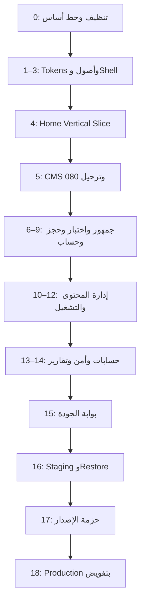

# الخطة التنفيذية الشاملة — موقع هبة الشريف

**النسخة المستهدفة:** تطبيق التصميم البصري المعتمد Master V2 على المشروع القائم، مع تطوير تجربة العميلة ولوحة الإدارة دون كسر البيانات أو الحجز أو الدفع أو الحماية.

**تاريخ الخطة:** 5 سبتمبر 2026  
**حالة الخطة:** جاهزة لبدء التنفيذ المحلي  
**قاعدة العمل:** لا انتقال إلى Staging أو Production ولا أي كتابة خارجية إلا بعد اجتياز البوابات ووجود تفويض صريح.

---

## 1. القرار التنفيذي

1. لن يُعاد بناء المشروع من الصفر؛ البنية الحالية كبيرة وناضجة ويجب تطويرها تدريجيًا.
2. جذر الأرشيف المرفوع هو مصدر الحقيقة المحلي، وليس `release/source`؛ الجذر يحتوي 80 ترحيلًا حتى `079` وحالة بتاريخ 2026-08-28، بينما النسخة الداخلية تحتوي 48 ترحيلًا فقط وحالة بتاريخ 2026-08-27.
3. الصورة المعتمدة مرجع بصري، وليست أصلًا يُقسّم إلى صور أو يُعرض كصفحة. كل النصوص والأزرار والمحتوى ستظل HTML دلاليًا وقابلًا للإدارة والبحث والوصول.
4. واجهة الجمهور ستجمع التحرير العربي، الفخامة الهادئة، السرد السينمائي والتفاعل المقصود. لوحة الإدارة ستستخدم مدرسة Product UX عملية وكثيفة المعلومات؛ ستشترك في الهوية من دون أن تتحول إلى واجهة سينمائية بطيئة.
5. “تحكم الإدارة في كل شيء” يعني تحكمًا كاملًا في المحتوى، الترتيب، الصور، الظهور، النشر، القبول والرفض والبيانات التشغيلية. لا يعني السماح بحقن HTML/CSS/JavaScript أو تغيير عشوائي لكل بكسل، لأن ذلك يكسر الهوية والأمان والاستجابة. التصميم سيُدار من حقول منظمة وقوالب آمنة ومعاينة وإصدارات.

---

## 2. حقائق النسخة المرفوعة

| البند | النتيجة |
|---|---:|
| بصمة SHA-256 للأرشيف | `34acdeea48e1a2555b9a8c02c5b031590a73c31a4672bbf216aa123683312634` |
| المسارات البرمجية | 86 صفحة/مسار |
| صفحات الجمهور | 33 |
| صفحات الإدارة | 30 |
| صفحات حساب العميلة | 11 |
| المكوّنات | 116 |
| ترحيلات قاعدة البيانات | 80 (`000`–`079`) |
| فحوص التدقيق والتحقق | 72 سكربتًا |
| إطار الواجهة | Next.js 16 + React 19 + Tailwind 4 |
| تشغيل Cloudflare | Vinext + Cloudflare Workers |
| البيانات والهوية والتخزين | Supabase |
| الاختبارات | Playwright + فحوص عقود محلية متعددة |

### سجل المراجع والأصول المعتمدة

يُستخدم هذا السجل لمنع استبدال مرجع بصري أو أصل بهوية مشابهة بالخطأ أثناء التنفيذ.

| الأصل/المرجع | المقاس | SHA-256 |
|---|---:|---|
| Master V2 — Desktop (`exec-4ee1f8cb-a45b-49f9-8c22-f64452b95d9d.png`) | 736×2135 | `cbea7a905c6a608a2ee1d738ef1fdb7a2ad780608ccd4be0a5f8d15f0712599e` |
| Master V2 — Mobile (`exec-56517496-8538-4b13-83dc-03df49417bb1.png`) | 724×2172 | `b29444e0d7d8b7673dec56cb4d6c52282b5e208cb50669bcbea226ec86a954c5` |
| Master V2 — Interaction detail (`exec-d9b501a1-3e5e-4c25-a752-75249b8b740b.png`) | 1586×992 | `7752e0dc93cc9dcbf82b6ca0875718bec337b3e19fefd49660f30909d8d8cc6c` |
| لوحة الألوان النهائية (DOCX المرفوع) | — | `ad7217efdc864acdd964e5ce1d19eb5b09c6029502a64bf80c369287db4e1ba8` |
| الشعار الرسمي `public/brand/main-logo.png` | 1254×1254 | `b9a03a3b088368879b6a80229cf7ac8e3645d9fe7e191460a8f5f7092a1c2ba5` |
| صورة Hero `public/brand/hero-reader-niqab-v1.jpg` | 1122×1402 | `bf4969b07eedb92ffc88634d298cc94a36817be020ac5662d3799419f456602b` |

المطابقة البصرية تستند إلى Master V2، بينما الأصول الفعلية المستعملة في الكود تظل الشعار وصورة Hero والوسائط المستقلة المعتمدة. لا تُقص الصورة المرجعية إلى أجزاء ولا تُعامل كأصل واجهة.

### تنبيهات يجب إغلاقها قبل أول تعديل

- الأرشيف المرفوع يحتوي `.env`؛ لن تُقرأ قيمه ولن يدخل أي تسليم أو Git.
- يحتوي الأرشيف كذلك `dist` و`release` و`playwright-report` و`test-results` وملفات بناء؛ كلها أدلة قديمة وليست مصدرًا صالحًا للتعديل.
- الأرشيف لا يحتوي تاريخ Git؛ لذلك يلزم إنشاء خط أساس محلي نظيف أو ربطه بالمستودع الأصلي قبل أي Push.
- التوثيق يسجل نجاح اختبارات سابقة، لكن الاعتماد الحقيقي يبدأ بإعادة تشغيل خط الأساس على النسخة المنظفة، لأن الاعتماد على تقرير قديم وحده غير كافٍ.
- الترحيلات `044`–`079` مصدرية ولم تُقبل حيًا على Staging، لذلك لا يجوز القفز إلى Production.

---

## 3. الثوابت غير القابلة للتغيير

### الهوية

- اللغة عربية أولًا، والاتجاه RTL أصيل.
- الشعار الرسمي هو الأصل الموجود في `public/brand/main-logo.png`.
- صورة السيدة المنقبة المعتمدة هي الأصل الموجود في `public/brand/hero-reader-niqab-v1.jpg`.
- الرسالة الأساسية: **«افهمي نفسكِ... واختاري حياة تشبهكِ أنتِ»**.
- الحجز خطوة مستقلة بعد الرسالة، ولا يُدمج داخل التوقيع الفكري للبراند.
- المؤهلات المثبتة: `ICF–ACC`، خبرة أكثر من 12 عامًا، أكثر من 100 شهادة متخصصة.
- لا صور شهادات أو أرقام أو آراء أو ظهور إعلامي غير موثقة من البيانات المنشورة.

### الممنوعات البصرية

- لا أوراق شجر جاهزة، ولا إحساس حديقة، ولا باقات نباتية.
- لا فندق أو Spa، ولا قالب Coaching عام، ولا Canva brochure.
- لا ذهبي لامع أو تأثيرات معدنية ثقيلة أو ظلال مبالغ فيها.
- لا أقواس في كل عنصر؛ القوس يُستخدم فقط كباب أو عتبة ذات معنى.
- لا ازدحام Glassmorphism، ولا تدرجات صاخبة، ولا أرقام ضخمة بلا وظيفة.

### الأمان والبيانات

- لا صلاحية إدارية تعتمد على إخفاء زر فقط؛ كل صلاحية تُراجع في الخادم وقاعدة البيانات.
- كل إضافة أو تعديل أو حذف أو نشر أو قبول أو رفض: تحقق، إذن، معاملة ذرية، سجل تدقيق، وحالة نجاح/فشل واضحة.
- الترحيلات إضافية فقط؛ لا تعديل لترحيل مطبق.
- لا أسرار أو مسارات تخزين خاصة أو بيانات عميلة في السجل أو حزمة المتصفح.
- لا بيانات تجريبية تُعرض كبيانات حقيقية، ولا أصفار مضللة عند فشل مصدر التشغيل.

---

## 4. النظام البصري النهائي

### الألوان الرسمية

| الرمز | اللون | النسبة التقريبية | الاستخدام |
|---|---|---:|---|
| `surface-primary` | `#F5F0E7` | 45% | الخلفية الأساسية والمساحات الهادئة |
| `surface-secondary` | `#E4D7C7` | 20% | خلفيات ثانوية وبطاقات مختارة |
| `brand-petrol` | `#2F6173` | 20% | الأزرار الرئيسية والأشرطة الداكنة |
| `luxury-champagne` | `#D8C3A5` | 8% | الحدود ومسار الضوء والتفاصيل |
| `emotion-burgundy` | `#7A2433` | 5% | التأكيد العاطفي والحالات المهمة |
| `support-olive` | `#6F6A2F` | 2% | علامة عضوية صغيرة عند الحاجة فقط |
| `text-primary` | `#263238` | — | النص الرئيسي |
| `text-secondary` | `#5B5A54` | — | النص المساعد |
| `text-on-dark` | `#F5F0E7` | — | النص فوق البترولي |

**إصلاح ملزم:** `burgundy` معرّف حاليًا في `src/styles/tokens.ts` و`src/app/globals.css` باللون البترولي `#2F6173`. سيُصحح إلى `#7A2433` مع تحديث تدقيق الألوان وحالات التباين.

### الخطوط

- العناوين: `Amiri Local` بأوزان 400/700.
- النصوص وعناصر الاستخدام: `IBM Plex Sans Arabic Local` بأوزان 400/500/600/700.
- لا خط خارجي في المسار الحرج، ولا اعتماد على اتصال Google Fonts.
- الحد الأدنى للنص الأساسي 16px، وعناصر الاستخدام المتكررة 14px، والبيانات الوصفية 12–13px فقط.

### الشبكة والمسافات

- سطح المكتب: 12 عمودًا، أقصى عرض للمحتوى 1280–1360px، فراغ أعمدة 24px.
- التابلت: 8 أعمدة، هوامش 32px.
- الموبايل: 4 أعمدة، هوامش 20–24px.
- إيقاع المسافات: مضاعفات 4/8px، مع 96–128px بين الأقسام على سطح المكتب و56–80px على الموبايل.
- ارتفاع عناصر اللمس الأساسية 48–52px.
- نصف قطر البطاقات 16–24px؛ الأزرار الرئيسية فقط يمكن أن تكون Pills.

### الحركة

- 180–240ms للأزرار والحالات الصغيرة.
- 300–500ms للكروت والصور والـ drawers.
- كشف الأقسام حتى 650ms، مرة واحدة وبمسافة حركة قصيرة.
- الحركة عبر `transform` و`opacity` فقط في المسارات المتكررة.
- وضع `prefers-reduced-motion` يلغي المسار المتحرك والـ parallax من دون فقد أي معلومة.
- ممنوع autoplay video في Hero.

### الصور

- صورة الـ Hero الحالية تُحافظ على هوية السيدة ووقارها.
- إنشاء أصول مستقلة نظيفة: عتبة/ممر ضوء، جلسة فردية، دورة، كتب. لا نصوص ولا Chrome داخل الصور.
- صور المقالات تأتي من أصول المقالات المنشورة والمعتمدة حقوقيًا، وليس من ثلاث صور ثابتة متكررة.
- تجهيز WebP/AVIF وأحجام responsive؛ لا استخدام `unoptimized` بلا مبرر موثق.
- كل صورة ذات معنى لها `alt` عربي دقيق؛ الزخرفة فقط تكون `alt=""`.

---

## 5. مواصفات الصفحة الرئيسية المعتمدة

| القسم | التنفيذ المرئي | مصدر المحتوى | تحكم الإدارة | اختبار القبول |
|---|---|---|---|---|
| Header | شريط خفيف Sticky، الشعار يمينًا، تنقل واضح، بحث/حساب، CTA، خط تقدم رفيع | `navigation_items` + إعدادات عامة | إضافة/تعديل/ترتيب/إخفاء الروابط، CTA | RTL، لوحة مفاتيح، Mobile drawer، لا تداخل 200% zoom |
| Hero | الصورة يسارًا على Desktop، الرسالة يمينًا، مساحة ضوء معمارية، زران ومسار ضوء | قسم Hero المنظم + أصل وسائط | النص، التوكيد، الزران، الصورة، الموضع، الوصف البديل، النشر | LCP، تباين، قص الصورة عند 360/390/768/1440، لا نص داخل الصورة |
| شريط المصداقية | ثلاث وحدات هادئة: ICF–ACC، 12+، 100+ | `owner_profile` كمصدر واحد | تعديل مؤهلات موثقة وحالتها | لا اختلاف بين صفحة عن هبة والرئيسية |
| Manifesto | ممر ضوء + «من الحيرة إلى الوضوح» + فهم/اختيار/حياة | قسم `manifesto` منظم | النص، الصورة، ترتيب النقاط، الظهور | لا نباتات، لا تكرار Hero، نص مقروء على البترولي |
| بوابات الخدمات | ثلاث بوابات: جلسات، دورات، كتب؛ جلسة Hover/Focus مميزة | بيانات الخدمات/الكتالوج المنشورة + إعدادات القسم | اختيار العناصر المنشورة وترتيبها وCTA والصورة | لا عنصر غير منشور، Hover لا يغير Layout، Touch بديل واضح |
| الاختبار الإرشادي | سؤال واحد في كل خطوة، 1 من 3، حالة اختيار، تقدم ونتيجة مبدئية | الإصدار المنشور من `guided_assessment_versions` | إدارة الأسئلة والخيارات والأوزان والإصدار والنشر من `/admin/assessments` | لا تخزين أو إرسال للإجابات، Keyboard كامل، Undo، نتيجة حتمية |
| المعرفة | بطاقة مميزة + بطاقتان أصغر، تصنيف ووقت قراءة وصورة حقيقية | مقالات منشورة مع غلاف وتاجات | اختيار Featured، الغلاف، الجدولة، ترتيب الظهور | لا صور ثابتة مزيفة، لا مقال مسودة، وقت القراءة محسوب |
| Quote | وقفة بصرية قصيرة بالاقتباس المعتمد | قسم `quote` منظم | النص، الظهور والترتيب | لا اقتباس منسوب بلا مصدر |
| CTA النهائي | خلفية عتبة ضوء، قرار واضح وزران | قسم `cta` منظم | النص، الأزرار، الوسائط، الظهور | الروابط داخلية وآمنة، CTA الحجز مستقل |
| Footer | شعار، وصف، روابط، Social، قانوني، عودة للأعلى | Navigation + إعدادات اجتماعية | الروابط والمجموعات والمنصات والظهور | إزالة `BotanicalSpray`، روابط HTTPS فقط، Accordion على الموبايل |

### قرار الموبايل

- لن يُضغط Desktop إلى عمودين صغيرين.
- تحت 768px يكون ترتيب Hero: الرسالة والأزرار أولًا، ثم الصورة، لضمان القراءة والقرار.
- شريط المصداقية يصبح سحبًا أفقيًا مع بديل Keyboard وأزرار واضحة.
- بوابات الخدمات صف واحد لكل بطاقة.
- الاختبار يعرض سؤالًا واحدًا وخيارات رأسية كاملة العرض.
- المقالات: بطاقة رئيسية ثم صفوف مختصرة.
- Footer يتحول إلى مجموعات قابلة للفتح مع بقاء القانوني ظاهرًا.

---

## 6. ربط التصميم بنظام الإدارة

### إعادة تنظيم مصدر الصفحة الرئيسية

الحالة الحالية تقسم Hero بين `site_settings.home_copy` وقسم `hero` فارغ. هذا يضاعف مصادر الحقيقة. التنفيذ المستهدف:

1. توحيد محتوى Hero داخل `page_sections.content` بصيغة Typed.
2. ترحيل قيم `home_copy` الحالية إلى قسم Hero مرة واحدة.
3. الاحتفاظ بقراءة fallback خلال إصدار انتقالي واحد ثم إيقاف المحرر المكرر.
4. إضافة نوعي قسم منظمين: `manifesto` و`quote`.
5. جعل `pathways` يقبل 3 عناصر افتراضيًا مع حد أقصى 4، بدل فرض أربعة دائمًا.
6. ربط مؤهلات الثقة بـ `owner_profile` لمنع تضارب الأرقام.
7. دعم اختيار الوسائط من مكتبة `public-media` فقط مع إثبات الحقوق.

### ما يستطيع الـ Owner التحكم فيه

- نصوص Hero، الكلمات الملوّنة، CTA، الصور، موضع القص والوصف البديل.
- ترتيب جميع أقسام الرئيسية وإظهارها وإخفاؤها.
- إضافة قسم من الأنواع المسموحة فقط، ومعاينته قبل النشر.
- نشر فوري أو جدولة بتوقيت القاهرة.
- اختيار المقالات والخدمات المميزة من السجلات المنشورة.
- تعديل Header/Footer والقوائم والروابط الاجتماعية.
- مراجعة النسخ السابقة واستعادة نسخة كمسودة.
- لا تحرير مباشر لـ CSS أو JavaScript أو HTML.

### دورة حياة كل محتوى

`مسودة → معاينة → مراجعة → مجدول/منشور → مؤرشف`

- كل انتقال له صلاحية مستقلة.
- حذف المحتوى المرتبط بتاريخ تجاري يتحول إلى Archive/Soft delete.
- الاستعادة لا تعيد النشر تلقائيًا.
- النشر يرفض أي رابط غير آمن أو صورة بلا حقوق أو عنصر مرتبط غير منشور.

---

## 7. تطوير جميع الصفحات العامة

| المجموعة | المسارات | التطوير المطلوب | مصدر الإدارة |
|---|---|---|---|
| التعريف والبداية | `/about`, `/start-here`, `/services` | نفس التحرير المعماري، عناوين أقصر، محتوى إنساني، اختبار تدريجي | Settings + Assessments + Services |
| الكتالوج | `/courses`, `/books`, `/workshops`, `/programs` وصفحات التفاصيل | بطاقات تحريرية، فلاتر واضحة، صور حقيقية، حالات Empty صادقة، CTA ثابت على الموبايل | Catalog/Courses/Books/Workshops/Products |
| المعرفة | `/articles`, `/resources`, `/press`, `/testimonials` | نظام بطاقات مقروء، تاجات، مدة، مصدر/موافقة/حقوق، بحث | Articles/Resources/Press/Reviews |
| العمليات | `/booking`, `/checkout/...` | Wizard واضح، ملخص ثابت، Hold وCountdown، إيصال، أخطاء قابلة للتعافي | Bookings/Availability/Payments/Settings |
| المساعدة | `/search`, `/contact`, `/faq` | بحث عربي، نماذج واضحة، نتائج/لا نتائج، موافقة الخصوصية | Content/Inbox/Pages |
| القانوني | `/privacy`, `/terms`, `/refund`, `/session-policy`, `/disclaimer` | قراءة طويلة مريحة، فهرس، تاريخ النسخة، Noindex للمسودة | Pages + Legal approval |
| الهوية | صفحات الدخول والتسجيل والاستعادة | غلاف هادئ، رسائل أمان مفهومة، أخطاء غير كاشفة | Auth + Security |

### قاعدة التوحيد

يتم تطوير Primitives والقوالب المشتركة أولًا، ثم تُرحّل الصفحات إليها. لا تُكتب 33 صفحة بتنسيقات متكررة؛ ذلك يقلل الانحراف والأخطاء ويجعل التعديل من الإدارة مستقرًا.

---

## 8. تطوير حساب العميلة

- Shell أخف من الإدارة ويحافظ على الدفء والوضوح.
- صفحة Home تعرض: الخطوة التالية، الحجوزات القادمة، الطلبات المنتظرة، التقدم، الإشعارات.
- الكتب: قارئ/تنزيل محمي ورسائل انتهاء الرابط.
- الدورات: منهج، تقدم، ملاحظات خاصة، موارد، فيديو محمي.
- الورش: تسجيل، موارد، تسجيلات منشورة، انتهاء الوصول.
- الحجوزات: إلغاء/إعادة جدولة/إضافة إلى التقويم وحالة الطلب.
- المدفوعات والطلبات: Timeline واضح وإعادة رفع إثبات عند الرفض.
- الحساب والأمان: الملف، تغيير كلمة المرور، الجلسات، طلب حذف الحساب.
- كل حالة كتابة تُثبت بعد إعادة التحميل ولا تعتمد على state محلي متفائل فقط.

---

## 9. مرحلة الإدارة الكاملة

### 9.1 الهيكل العام

- Sidebar قابل للطي على Desktop وDrawer كامل على Mobile.
- Topbar: بحث شامل، اختصارات، تنبيهات تشغيل، حساب، حالة البيئة.
- Command search يصل إلى عميلة/طلب/حجز/منتج/مقال حسب الصلاحية.
- Page header موحد: عنوان، وصف، إجراء رئيسي، حالة المصدر.
- فلاتر قابلة للحفظ دون تخزين PII في Local Storage.
- جداول ذات Header ثابت، Pagination حقيقية، Empty/Error/Loading واضح.
- Bulk actions فقط عندما تكون المعاملة آمنة وقابلة للتدقيق.

### 9.2 لوحة النظرة العامة

- إيراد اليوم/الشهر/الفترة.
- مدفوعات تنتظر المراجعة، طلبات، حجوزات، إعادة جدولة.
- جدول اليوم والأسبوع.
- أكثر المنتجات أداءً، إكمال الدورات، استخدام الجلسات والباقات.
- تنبيهات النظام، موانع الإطلاق، فشل البريد أو الملفات.
- لا أرقام صفرية عند فشل الاتصال؛ تعرض الحالة كـ “تعذرت القراءة”.

### 9.3 إدارة المحتوى والصفحات

- الصفحات، الأقسام، Header/Footer، المقالات، الموارد، الظهور الإعلامي، الاختبار، التقييمات.
- Add/Edit/Archive/Restore/Preview/Schedule/Publish.
- ترتيب أقسام Drag + أزرار رفع/خفض قابلة للوصول.
- معاينة Desktop/Tablet/Mobile من نفس البيانات المحفوظة.
- Revision diff مفهوم بالعربية قبل الاستعادة.
- لا محرر JSON للمالكة في المسار اليومي؛ حقول عربية منظمة.

### 9.4 الكتالوج والتعلم

- المنتجات العامة والحزم وVIP والموارد المجانية.
- الدورات والوحدات والدروس والفيديو والموارد.
- الكتب والإصدارات والملفات المحمية.
- الورش والمواعيد والسعة والحضور والتسجيلات.
- الخدمات والأسعار والمدة والتوافر.
- Checklist جاهزية يمنع النشر قبل اكتمال البيانات والحقوق والتسليم.

### 9.5 الحجوزات والمدفوعات والطلبات

- أجندة يوم/أسبوع/شهر مع فلاتر وبحث.
- قبول/رفض إعادة الجدولة، تأكيد، إكمال، إلغاء، No-show.
- إدارة قواعد التوافر والاستثناءات ومدة الخدمة والفواصل.
- عرض إثبات الدفع برابط قصير، ثم قبول/رفض مع سبب.
- Refund كدورة حالات: requested/processing/completed/failed.
- أي قبول أو رفض مالي يحتاج Fresh MFA.
- كل عملية ذرية مع إشعار العميلة وسجل التدقيق.

### 9.6 الحسابات والعملاء Customer 360

- قائمة حسابات مع بحث Parametrized وPagination.
- الملف، الطلبات، المدفوعات، الحجوزات، الاشتراكات، الوصول، التقدم، الرسائل.
- ملاحظات وتاجات داخلية مع Archive/Restore.
- إرسال إشعار منظم دون كشف بيانات في السجل.
- طابور طلبات حذف الحساب مع مراجعة وتنفيذ موثق.
- ممنوع حذف تاريخ مالي أو وصول مدفوع بلا سياسة احتفاظ واضحة.

### 9.7 الأدوار والصلاحيات

- الأدوار الحالية: Owner, Admin, Operations, Finance, Content, Marketing, Support, Editor.
- عرض Matrix كاملة: View/Create/Edit/Delete/Publish/Approve/Reject/Export.
- Owner فقط يغير الأدوار وصلاحياتها.
- منع تغيير الدور الذاتي ومنع إزالة آخر Owner.
- Step-up MFA لأي تغيير صلاحيات.
- تجربة Role simulation للعرض فقط، ولا تغير صلاحية الجلسة الحقيقية.

### 9.8 سجل الدخول والأمان

صفحة أرشيف مستقلة أو Tab داخل `/admin/security` تشمل:

- كل أحداث الدخول الناجح والفاشل وMFA وإلغاء الجلسات وإعادة التحقق.
- التاريخ والوقت بتوقيت القاهرة، الحساب الإداري، نوع الحدث، النتيجة، الجهاز المسمى، حالة الجلسة.
- فلترة حسب الحساب/الحدث/النتيجة/الفترة، Pagination وExport محمي.
- تفاصيل آمنة: معرفات مختصرة وRequest fingerprint مجزأ عند الحاجة للمطابقة.
- لا IP خام، ولا User-Agent خام، ولا Token، ولا كلمة مرور.
- الجلسات النشطة: الجهاز، الإنشاء، آخر نشاط، انتهاء الخمول، الانتهاء المطلق، إلغاء جلسة/كل الجلسات الأخرى.
- الاحتفاظ الزمني لا يُحذف تلقائيًا قبل اعتماد سياسة قانونية؛ الواجهة تعرض ما هو محفوظ فعلًا.

### 9.9 سجل التدقيق العام

- تطوير العرض الحالي المحدود بآخر 200 حدث إلى Cursor pagination.
- بحث وفلترة حسب المنفذ، الإجراء، الكيان، الفترة والنتيجة.
- ترجمة أسماء الأحداث للعربية مع الاحتفاظ بالكود التقني في التفاصيل.
- عرض Before/After metadata الآمنة عند وجودها، من دون محتوى شخصي أو أسرار.
- Export يحتاج `audit.view` وFresh MFA إذا احتوى نطاقًا واسعًا.

### 9.10 الإحصائيات والتحليلات

**تشغيلية بلا تتبع سلوكي:** الإيرادات، التحويلات المالية، الحجوزات، الإلغاءات، الحضور، الاشتراكات، التقدم، اكتمال الدورات، أداء المحتوى المنشور.

**سلوكية بعد الموافقة القانونية فقط:** الزيارات، البحث، مسار التحويل، CTA، ترك الـ Wizard. قبل تفعيلها يجب استبدال الإدخال المجهول المباشر الحالي ببوابة Server-mediated تسمح بأحداث محددة، Rate limit، Payload محدود، وعدم إرسال PII.

### 9.11 حالة النظام

- حالة Supabase/Storage/Email/Sentry/Scanner/Cloudflare دون عرض قيم أسرار.
- فصل واضح بين: مثبت حيًا، مثبت محليًا، مهيأ فقط، غير متحقق، فشل.
- سجل أخطاء قابل للتصفية، وRetry للمهام الآمنة فقط.
- Readiness checklist قبل Staging/Production.

---

## 10. تغييرات البيانات المتوقعة

كل التغييرات تضاف بعد `079` ولا تعدّل ملفات مطبقة.

### Migration 080 — Home Master V2 governance

- السماح المنظم بنوعي `manifesto` و`quote`.
- تحديث RPC إدارة الأقسام مع نفس قفل الصفحة والصلاحية والمراجعة والتدقيق.
- Backfill محتوى Hero من `home_copy` إلى قسم Hero دون حذف القديم فورًا.
- إضافة بنية حقول الوسائط/القص/الوصف البديل داخل JSON المنظم مع حدود حجم.
- الحفاظ على الأقسام الأساسية `hero/pathways/cta` ومنع كسر صفحة منشورة.

### Migration 081 — Security and login archive read model

- RPC قراءة فقط للأرشيف، يعيد حقولًا مسموحة ومحدودة.
- إعادة فحص `system.view` أو `audit.view` داخل PostgreSQL.
- Cursor pagination وفلاتر bounded.
- لا توسيع لجمع IP أو User-Agent.
- تدقيق عمليات التصدير والاستعلامات الحساسة دون تسجيل معايير تحتوي PII.

### Migration 082 — Governed analytics (عند اعتماد التتبع)

- إلغاء الإدخال المجهول المفتوح المباشر.
- Allowlist لأسماء الأحداث والخصائص.
- Server-only RPC + Rate limit + Payload cap + Consent state.
- فصل الأحداث التشغيلية عن السلوكية.
- سياسة احتفاظ معتمدة قبل أي حذف آلي.

**ترتيب Staging الإلزامي:** استعادة مستقلة ناجحة → تطبيق `044` حتى آخر ترحيل بالترتيب → اختبارات RLS/RPC/Auth/Storage → قبول → فقط بعدها خطة Production.

---

## 11. مراحل التنفيذ التفصيلية

### المرحلة 0 — استلام آمن وخط أساس

**العمل**

- إبقاء ZIP الأصلي Read-only وتسجيل بصمته.
- إنشاء نسخة عمل نظيفة من الجذر فقط.
- استبعاد `.env`, `dist`, `release`, التقارير، نتائج الاختبار، cache وملفات البناء.
- الاحتفاظ بـ `.env.example` فقط.
- مطابقة Node و`pnpm@10.13.1` مع `packageManager` وعدم تغيير lockfile.
- إنشاء Git checkpoint محلي نظيف أو ربط المستودع الأصلي دون Push.
- تشغيل baseline: type-check، lint، العقود، Next build، Worker build، E2E العام.

**بوابة القبول**

- لا أسرار في Git أو الحزمة.
- لا اعتماد على `dist` القديم.
- توثيق أي فشل حقيقي قبل التعديل؛ لا بدء بصري فوق baseline مكسور.

### المرحلة 1 — عقد التصميم والـ Tokens

**العمل**

- تثبيت لوحة الألوان والخطوط والمسافات والظلال والحركة والـ breakpoints.
- إصلاح burgundy وإضافة beige/olive الرسميين.
- تحديث Light/Dark مع فحص contrast.
- إنشاء Style reference route داخل Preview فقط أو Story surface غير منشورة.
- تحديث `audit:colors` لمنع انحراف الألوان.

**بوابة القبول**

- كل الألوان تأتي من Tokens.
- لا كلاس لون عام خارج النظام.
- AA للنصوص والأزرار، وFocus واضح.

### المرحلة 2 — الأصول والـ Primitives

**العمل**

- تجهيز الصور المعمارية والخدمية كأصول مستقلة.
- تحسين `Button`, `Card`, `Section`, `PageHero`, `ProductCard`, `Badge`, `Table`, `FormField`, `Sidebar`.
- إضافة Primitives: `SectionHeading`, `MediaFrame`, `PortalCard`, `ProgressSteps`, `AdminPageHeader`, `FilterBar`, `Pagination`, `StatusBanner`.
- توحيد Loading/Error/Empty/404.

**بوابة القبول**

- Keyboard/Touch/200% zoom.
- لا Layout shift عند الصور أو حالات التحميل.
- لا أصل بلا أبعاد/حقوق/alt مناسب.

### المرحلة 3 — Header, Footer, Global shell

**العمل**

- تنفيذ Header المعتمد وخط تقدم الصفحة.
- Mobile drawer مع focus trap وإغلاق Escape وإعادة التركيز.
- إزالة `BotanicalSpray` من Footer.
- إضافة Footer groups وSocial links المنظمة وBack-to-top.
- ضمان Skip link وLandmarks وActive navigation.

**بوابة القبول**

- 360/390/768/1024/1440 بلا overflow.
- تنقل كامل بلوحة المفاتيح.
- لا كسر لأي Route أو Feature flag.

### المرحلة 4 — الصفحة الرئيسية Vertical Slice

**العمل**

- Hero → Trust → Manifesto → Service portals → Guided assessment → Articles → Quote → CTA.
- ربط كل قسم ببيانات حقيقية أو Empty state صادق.
- تفعيل الحركة الهادئة مع reduced-motion.
- عدم إدخال Testimonials/Press/Offers في المواضع غير الموجودة بالتصميم؛ تظل أقسامًا اختيارية يمكن إدارتها وإظهارها دون تغيير الهيكل الأساسي.

**بوابة القبول**

- مطابقة بصرية للمرجع عند 1440 و390 مع تطوير القراءة على الموبايل.
- جميع CTAs حقيقية.
- لا نص أو زر داخل صورة.
- الصفحة تعمل بلا Supabase بحالات صادقة، وتستهلك المنشور فقط عند التهيئة.

### المرحلة 5 — CMS الصفحة الرئيسية

**العمل**

- Migration 080 وتحديث الأنواع والمطبعّات والإجراءات.
- محرر Hero منظم وإزالة الازدواج مع Settings.
- محررات Manifesto/Quote/Pathways/CTA/Articles selection.
- Preview responsive، ترتيب، جدولة، Revision، Archive.

**بوابة القبول**

- تعديل → Reload → Persisted.
- مستخدم بلا إذن يُرفض في UI/Server/DB.
- Audit + Revision في نفس المعاملة.
- لا يمكن نشر صفحة تكسر الأقسام الأساسية.

### المرحلة 6 — الصفحات العامة

- ترحيل القوالب العامة بالدفعات: تعريف → كتالوج → معرفة → مساعدة → قانوني.
- كل دفعة تُقفل باختبارات Routes وMobile وEmpty/Error.
- لا تغيير في منطق النشر أو الاستحقاق أثناء تحسين الشكل.

### المرحلة 7 — الاختبار الإرشادي

- Refactor لمحرك مشترك يعرض سؤالًا واحدًا في كل خطوة.
- نفس الإصدار المنشور في الرئيسية و`/start-here`.
- إجابات React memory فقط؛ لا Server request ولا Analytics.
- Undo/Edit، Progress، إعلان النتيجة لقارئ الشاشة.

### المرحلة 8 — الحجز والدفع

- تحسين Wizard مع الحفاظ على Hold/Overlap/Expiry/Payment proof.
- ملخص طلب ثابت، استعادة من خطأ الشبكة، منع Double submit.
- Desktop/Mobile/Keyboard ووقت القاهرة.
- لا تعديل Schema تشغيلي جديد قبل قبول الترحيلات القائمة على Staging إلا إذا كان إصلاحًا محليًا إضافيًا مستقلًا.

### المرحلة 9 — حساب العميلة

- Shell والصفحة الرئيسية للحساب.
- الكتب/الدورات/الورش/الحجوزات/الطلبات/المدفوعات/الإعدادات.
- اختبار الوصول المحمي، الروابط الموقعة، انتهاء الصلاحية، وعزل مستخدمين.

### المرحلة 10 — أساس الإدارة المرئي

- Admin shell/topbar/sidebar/command search.
- حالات المصدر والجداول والفلاتر والنماذج.
- التصميم عملي، سريع، بلا صور زخرفية.

### المرحلة 11 — إدارة المحتوى والكتالوج

- Pages/Home/Navigation/Media/Articles/Resources/Press/Reviews/Assessments.
- Products/Courses/Curriculum/Books/Workshops/Services/Memberships.
- كل صفحة تُراجع مقابل مصفوفة CRUD/Publish/Archive/Preview/Audit.

### المرحلة 12 — الإدارة التشغيلية

- Bookings/Availability/Orders/Payments/Refunds/Inbox/Newsletter/Notifications.
- قبول/رفض/إسناد/ملاحظات/إشعارات/Outbox retry.
- اختبارات concurrency والفشل الجزئي وإعادة المحاولة.

### المرحلة 13 — الحسابات والصلاحيات والسجلات

- Customer 360 وطابور حذف الحساب.
- Roles/permissions matrix وFresh MFA.
- Migration 081، أرشيف الدخول، الجلسات، سجل التدقيق المتقدم والتصدير.

### المرحلة 14 — التقارير والتحليلات

- تحسين التقارير التشغيلية والفترات والمقارنات.
- إضافة Funnel فقط بعد Migration 082 واعتماد الخصوصية.
- CSV محمي ضد Formula injection، محدود الصفوف والفترة ومُدقق.

### المرحلة 15 — الجودة الشاملة

- Type/Lint/Build/Worker build.
- جميع العقود الحالية والجديدة.
- E2E الجمهور والحساب والإدارة.
- Visual regression وLight/Dark/RTL/Reduced motion.
- Accessibility وPerformance وSecurity وSEO.
- إصلاح كل فشل ثم إعادة البوابة كاملة؛ لا Waiver صامت.

### المرحلة 16 — Staging الآمن

- Recovery point/Backup/Restore drill أولًا.
- Staging مستقل ومعزول وNoindex وبيانات اختبار فقط.
- تطبيق الترحيلات بالترتيب.
- Auth/MFA/RLS/Storage/Email/Sentry/Scanner.
- رحلات كاملة: تسجيل، شراء، إثبات دفع، قبول/رفض، حجز، محتوى محمي، Admin، سجلات.

### المرحلة 17 — الإصدار والتسليم

- `check:deploy` + Worker E2E + `package:release` + فحص أسرار أخير.
- إنشاء حزمة مصدر نظيفة فقط؛ لا `.env` ولا تقارير ولا build artifacts.
- Manifest وبصمة SHA-256 وتقرير قبول وKnown issues صريح.
- تسليم الملف النهائي مع دليل تشغيل مختصر.

### المرحلة 18 — Production بعد التفويض

- Change window وخطة Rollback.
- تطبيق الترحيلات المعتمدة فقط.
- نشر Worker، Smoke tests، Logs/alerts، DNS/Auth redirects.
- مراقبة 24–48 ساعة ثم إغلاق الإصدار.

---

## 12. مصفوفة الاختبارات الإلزامية

| المجال | الاختبارات |
|---|---|
| بصري | 1440/1280/1024/768/430/390/360، Light/Dark، لقطة كاملة وFold، فرق بصري معتمد |
| RTL | ترتيب القراءة، الأيقونات الاتجاهية، أرقام/بريد/هاتف LTR islands، عدم قص الحروف |
| وصول | Keyboard فقط، Focus، Skip link، Dialog/Drawer trap، Labels، Errors، 200% zoom، Reduced motion |
| أداء | LCP/INP/CLS، حجم Hero، lazy loading، bundle delta، عدم layout/paint animation المتكرر |
| CMS | CRUD، ترتيب، معاينة، جدولة القاهرة، نشر، أرشفة، Revision، Restore كمسودة |
| صلاحيات | كل Role: السماح المتوقع + رفض إجراء واحد على الأقل في كل Domain |
| إدارة | Reload persistence، Double submit، Partial failure، Audit، Feedback |
| حجز | Hold expiry، overlap، وقت القاهرة/DST، إلغاء، إعادة جدولة، ICS، package credits |
| تجارة | Server-trusted price، كوبون، Proof، قبول/رفض، Refund، Entitlement، idempotency |
| ملفات | MIME/حجم/Magic bytes، signed URLs، انتهاء، rate/device limits، archive/restore |
| أمن | RLS، MFA/AAL2/Fresh MFA، sessions، rate limits، CSP، XSS، injection، secrets scan |
| SEO | Metadata، canonical، sitemap، robots، Schema، noindex للمسودات/المعاينة/البحث |
| حالات الفشل | Source unconfigured، query failure، empty، 404، offline/retry، provider disabled |

---

## 13. ميزانيات الأداء

- LCP عند p75: **≤ 2.5 ثانية** على Mobile وDesktop في Staging.
- INP عند p75: **≤ 200ms**.
- CLS عند p75: **≤ 0.1**.
- صورة LCP: هدف ≤ 250KB مع أبعاد ثابتة وPreload واحد فقط.
- جميع صور ما تحت Fold: Lazy.
- لا زيادة في JavaScript الابتدائي للرئيسية بأكثر من 10% من baseline إلا بسبب وظيفة معتمدة ومقاسة.
- لا Scroll listener غير throttled، ولا Animation تحرك Layout.
- Accessibility Lighthouse هدف ≥ 95، وPerformance هدف ≥ 90 على Staging الواقعي؛ لا تعتمد الأرقام المحلية وحدها.

---

## 14. بوابة الدرجة النهائية من 100

| المجال | الوزن | شرط الحصول على الدرجة |
|---|---:|---|
| الهوية والمطابقة البصرية | 15 | الشكل المعتمد حاضر بلا نباتات/قالب عام/تشوه ألوان |
| وضوح UX ومسارات القرار | 10 | الرسالة والخدمات والاختبار والحجز بلا التباس |
| Responsive وRTL | 10 | جميع المقاسات بلا overflow أو ضغط نص |
| الوصول | 10 | Keyboard/Focus/Zoom/Screen reader/Reduced motion |
| الأداء | 10 | تحقيق الميزانيات السابقة على Staging |
| وظائف الجمهور والحساب | 10 | جميع الرحلات الأساسية تعمل وتستمر بعد Reload |
| لوحة الإدارة والتحكم | 15 | CRUD/Publish/Approve/Reject/Stats/Preview كاملة وحقيقية |
| الأمان والخصوصية | 10 | RLS/MFA/Sessions/Logs/Uploads/No secrets |
| البيانات والترحيلات | 5 | ترتيب/Restore/Staging/Atomicity مثبتة |
| الاختبارات والتسليم | 5 | جميع البوابات وحزمة نظيفة وتقرير قبول |

**قاعدة الحسم:** لا تُسمى النسخة “نهائية” إذا وُجد P0 مفتوح، حتى لو كان شكلها ممتازًا.

---

## 15. نقاط التوقف الحقيقية فقط

العمل المحلي من المرحلة 0 إلى 15 لا يحتاج أسئلة إضافية ما دامت الأصول المعتمدة متاحة. التوقف يكون فقط عند:

1. حاجة فعلية إلى بيانات/أسعار/نص قانوني لم تعتمده المالكة.
2. حاجة إلى صلاحية Provider أو سر يجب إدخاله في البيئة الآمنة، وليس في المحادثة.
3. انتقال إلى Staging أو Production أو DNS أو تطبيق ترحيلات خارجية.
4. تعارض مثبت بين الأرشيف المرفوع والمستودع الأصلي لا يمكن حسمه بالملفات.

---

## 16. أول شريحة تنفيذ عند البدء

1. تنظيف المصدر وتثبيت baseline.
2. إصلاح Tokens والـ burgundy والـ dark palette.
3. تنفيذ Header + Hero + Trust rail فقط داخل مصدر الصفحة الحقيقي.
4. تشغيل Type/Lint/Build واختبارات Home/RTL/Mobile.
5. إنتاج لقطتي 1440 و390 للمراجعة الداخلية مقابل المرجع.
6. عند نجاحها، الاستمرار تلقائيًا إلى بقية الصفحة الرئيسية ثم CMS؛ لا فتح Backend جديد قبل إغلاق الشريحة المرئية.

هذه الشريحة صغيرة بما يكفي لاكتشاف الانحراف مبكرًا، وكاملة بما يكفي لإظهار الهوية الحقيقية في الكود بدل انتظار نهاية المشروع.

---

## 17. تعريف الانتهاء

يعتبر المشروع مكتملًا فقط عندما:

- التصميم المعتمد منفذ فعليًا على الجمهور والموبايل، وليس Screenshot.
- كل المحتوى المرئي الأساسي قابل للإدارة من حقول منظمة.
- جميع صفحات الجمهور والحساب والإدارة تستخدم النظام الموحد.
- الإضافة والتعديل والحذف/الأرشفة والنشر والقبول والرفض حقيقية ومستمرة ومُدققة.
- أرشيف الدخول والحسابات والصلاحيات والإحصائيات يعمل حسب الإذن.
- اختبارات Next وWorker وE2E والأمن والوصول والأداء ناجحة.
- Staging اجتاز الاستعادة والترحيلات والرحلات الحية.
- حزمة التسليم لا تحتوي أسرارًا أو نتائج بناء أو تقارير خاصة.
- Known issues لا يحتوي P0، وأي P1/P2 متبقٍ معلن بدقة.

---

## 18. مصفوفة المهارات ومسارات العمل

هذه ليست خطة Frontend فقط. كل مسار له مخرجات واختبار قبول مستقل، ولا يُغلق لمجرد أن الشكل أصبح جميلًا.

| المسار/المهارة | مسؤوليتها في المشروع | المخرج الملزم | بوابة القبول |
|---|---|---|---|
| استراتيجية البراند | حفظ الرسالة والهوية ومنع الشكل العام | Brand contract + قائمة المسموح والممنوع | لا نص أو لون أو صورة تناقض الثوابت |
| UX Research وProduct Strategy | ترتيب القرار وفهم احتياجات الزائرة | خريطة نوايا ومسارات وأولويات | كل CTA له سبب ووجهة وقياس نجاح |
| Information Architecture | توحيد التنقل والتصنيفات والبحث | Sitemap وNavigation model | لا صفحة يتيمة ولا اسم متضارب |
| UI وDesign Systems | تحويل Master V2 إلى نظام قابل للتوسع | Tokens وPrimitives وحالات كاملة | لا Hard-coded drift ولا مكوّن بلا حالات |
| Arabic Editorial Design | الإيقاع العربي والهرمية وطول السطر | قواعد عناوين ونصوص وMicrocopy | قراءة طبيعية بلا كسور أو حشو تسويقي |
| RTL Engineering | الاتجاه المختلط والأيقونات والترتيب | RTL contract وLTR islands | لا انعكاس خاطئ ولا قص أو ترتيب مربك |
| Interaction وMotion | جعل التجربة حية بلا إزعاج | Motion tokens وحالات Focus/Hover/Touch | لا تغيير Layout ولا فقد معلومة مع Reduced Motion |
| Frontend Architecture | Server/Client boundaries وإعادة الاستخدام | قوالب ومكوّنات Typed | Bundle مضبوط ولا تكرار منطق بين الصفحات |
| Backend/Application Logic | الإجراءات والمعاملات والتكاملات | Server actions/RPC contracts | Idempotency وValidation وFeedback حقيقي |
| PostgreSQL/Supabase | المخطط وRLS وRPC والترحيلات | Migrations واختبارات allow/deny | لا جدول مكشوف ولا ترحيل غير قابل لإعادة الإنتاج |
| Security Engineering | MFA والجلسات والرفع والسجلات والأسرار | Threat model وضوابط واختبارات | رفض Server/DB مثبت، ولا سر في Browser/Archive |
| Privacy Engineering | تقليل البيانات والاحتفاظ والتصدير | Data inventory وRetention decisions | لا تتبع سلوكي أو PII بلا أساس واعتماد |
| Admin Product UX | تحكم كامل منظم وسريع | CRUD/Publish/Approve/Reject/Stats workflows | كل زر حقيقي ومستمر ومُدقق |
| Booking/Commerce | سلامة السعر والحجز والدفع والاستحقاق | State machines وعقود concurrency | لا Double booking أو Double submit أو سعر من العميل |
| Analytics | فصل الحقيقة التشغيلية عن السلوك | Metrics dictionary ومصادر بيانات | كل رقم له تعريف ومصدر وحالة فشل صريحة |
| Accessibility | WCAG 2.2 AA عبر العملية كاملة | Test matrix يدوية وآلية | Keyboard/Focus/Reflow/Auth/Errors ناجحة |
| Performance Engineering | الصور وRSC وJavaScript وCWV | Budget وقياس Baseline/After | LCP/INP/CLS ضمن الحدود على Staging |
| SEO/Content Discovery | Metadata وSchema والبحث والفهرسة | SEO templates وSitemap/Robots | Canonical صحيح ولا مسودة مفهرسة |
| QA Automation | العقود وE2E والمرئي والفشل | Suites قابلة للإعادة وأدلة | لا P0، ولا فشل متجاهل أو اختبار شكلي |
| DevOps/Release | البيئات والأسرار والنشر والرجوع | Staging gates وحزمة نظيفة وRunbook | Restore وRollback وSmoke مثبتة |
| Media/حقوق المحتوى | جودة الصور والملكية والوصف البديل | Media manifest | لا أصل مجهول الحقوق أو بلا Alt/Dimensions |

### نظام التعاون بين المسارات

- قرار البراند يسبق إنتاج الأصل؛ لا تُنتج صورة ثم نحاول تبريرها.
- عقد البيانات يسبق محرر الإدارة؛ لا نبني Form قبل معرفة المصدر والصلاحية ودورة الحالة.
- المكوّن العام يسبق ترحيل الصفحات؛ لا نكرر الخطأ 33 مرة.
- اختبار Allow/Deny يُكتب مع الترحيل نفسه، وليس بعد اكتمال الواجهة.
- الأداء والوصول جزء من كل Pull Request/Checkpoint، وليسا مرحلة تجميل أخيرة.
- كل مرحلة تنتج: كودًا، اختبارًا، دليلًا مرئيًا أو تشغيليًا، وتحديثًا لـ `docs/PROJECT_STATE.md` و`docs/DECISIONS.md` عند وجود قرار جديد.

---

## 19. خريطة الملفات المستهدفة

الخريطة التالية تحدد أماكن العمل مسبقًا. أسماء الملفات الجديدة المقترحة نهائية مبدئيًا، وتُراجع فقط إذا كشف الخط الأساس تعارضًا حقيقيًا.

| النطاق | الملفات الحالية الأساسية | الملفات/التغييرات المتوقعة |
|---|---|---|
| Tokens والسطح العام | `src/styles/tokens.ts`, `src/app/globals.css`, `src/app/layout.tsx` | تصحيح الألوان، Dark tokens، الحركة، الشبكة، قواعد RTL وFocus |
| Shell الجمهور | `src/components/layout/PublicFrame.tsx`, `PublicHeader.tsx`, `PublicFooter.tsx`, `BrandLogo.tsx` | Header/Desktop/Mobile، Progress line، Footer accordion، إزالة استخدام `BotanicalSpray` |
| الصفحة الرئيسية | `src/app/(public)/page.tsx`, `src/components/home/HomeSectionRenderer.tsx`, `Hero.tsx`, `TrustStrip.tsx`, `JourneyMap.tsx`, `ServiceCards.tsx`, `FeaturedArticles.tsx`, `FinalCta.tsx` | إعادة بناء الأقسام المعتمدة وإنشاء `ManifestoSection.tsx`, `ServicePortals.tsx`, `GuidedAssessmentSection.tsx`, `QuoteSection.tsx` عند الحاجة |
| عقد بيانات الرئيسية | `src/lib/home/sections.ts`, `src/lib/data/home.ts`, `src/lib/actions/cms.ts` | Typed schemas، تطبيع المحتوى، transitional fallback، اختيار المنشور فقط |
| محرر الرئيسية | `src/components/admin/HomeCopyEditor.tsx`, `HomeSectionManager.tsx`, `CmsStructureManager.tsx`, `MediaPickerField.tsx`, `PreviewButton.tsx` | محررات حقول عربية، responsive preview، ترتيب، جدولة، revision |
| الاختبار الإرشادي | `src/components/catalog/StartHereQuiz.tsx`, `src/app/(public)/start-here/page.tsx`, `src/components/admin/AssessmentManager.tsx`, `src/lib/actions/assessments.ts` | محرك مشترك، سؤال/خطوة، ذاكرة React فقط، نفس الإصدار المنشور |
| القوالب العامة | `src/components/catalog/PageHero.tsx`, `ProductCard.tsx`, `CmsControlledProsePage.tsx`, `ProsePage.tsx`, `MobileBuyBar.tsx` | Primitives المعتمدة وحالات Loading/Empty/Error وSEO موحد |
| الحساب | `src/components/layout/DashboardShell.tsx`, `src/app/dashboard/**` | Shell جديد، Next action، Timelines، حالات الحماية والانتهاء |
| Shell الإدارة | `src/app/admin/layout.tsx`, `src/components/layout/AdminShell.tsx`, `src/components/admin/AdminTopbar.tsx`, `AdminDataTable.tsx`, `AdminEditorShell.tsx` | Command search، Page header، filters، pagination، source/status banners |
| المحتوى والكتالوج | `src/app/admin/pages/**`, `articles/**`, `media/**`, `products/**`, `courses/**`, `books/**`, `workshops/**` ومكوّناتها | CRUD/Preview/Schedule/Publish/Archive/Restore وReady-to-publish checklists |
| العمليات | `src/app/admin/bookings/**`, `orders/**`, `payments/**`, `inbox/**` و`src/lib/actions/booking-*.ts`, `checkout.ts`, `admin-control.ts` | قبول/رفض، Fresh MFA، إشعارات، معاملات ذرية، حالات فشل جزئي |
| الحسابات والصلاحيات | `src/app/admin/users/**`, `roles/**`, `src/components/admin/Customer360Actions.tsx`, `RolePermissionEditor.tsx`, `src/lib/auth/permissions.ts` | Matrix كاملة، منع self-escalation، آخر Owner، Role simulation للعرض |
| الأمن والسجلات | `src/app/admin/security/**`, `audit-logs/**`, `src/components/admin/AdminSessionsPanel.tsx`, `AdminSessionMonitor.tsx`, `src/lib/actions/admin-sessions.ts` | `LoginArchiveTable.tsx` وFilters/Details/Export، cursor pagination، revoke session |
| التقارير | `src/app/admin/reports/**`, `src/components/admin/Charts.tsx`, `ReportExportPanel.tsx`, `src/lib/actions/reports.ts`, `src/lib/analytics.ts` | Metrics dictionary، comparisons، guarded CSV، governed analytics فقط |
| قاعدة البيانات | `supabase/migrations/000*`–`079*` كمصدر تاريخي لا يُعدل | `080_home_master_v2_governance.sql`, `081_security_login_archive.sql`, و`082_governed_analytics.sql` عند الاعتماد |
| الاختبارات | `tests/e2e/public.spec.ts`, `tests/e2e/admin.spec.ts`, `scripts/verify-*.mjs`, `scripts/audit-*.mjs` | عقود لكل نوع قسم/Role/RPC، لقطات 1440/390، اختبارات فشل وAllow/Deny |
| التوثيق والإصدار | `docs/PROJECT_STATE.md`, `docs/DECISIONS.md`, `docs/KNOWN_ISSUES.md`, `scripts/package-release.mjs` | تحديثات مرحلية، دليل Admin، Runbook، manifest وحزمة إصدار نظيفة |

### قواعد التعديل داخل الملفات

- لا يُستبدل ملف كبير بالكامل إذا كان Patch محدودًا يحافظ على منطق قائم ومختبر.
- أي مكوّن Client جديد يحتاج مبررًا؛ القراءة الأساسية تظل Server-rendered ما أمكن.
- لا تُنقل صلاحية من PostgreSQL إلى TypeScript فقط.
- لا تُحذف المكوّنات القديمة قبل انعدام الاستدعاءات ونجاح العقود؛ تزال في Cleanup checkpoint منفصل.
- لا تُستخدم الصورة المرجعية كـ background واحدة تغطي الصفحة.

---

## 20. موجات التنفيذ والتبعيات

| الموجة | تضم | لا تبدأ قبل | مخرج القرار |
|---|---|---|---|
| A — Foundation | 0–3 | المصدر والأصول | Baseline + نظام بصري + Shell مقبول |
| B — Public Core | 4–7 | نجاح A | الرئيسية وCMS والاختبار الإرشادي |
| C — Journeys | 8–9 | نجاح العقود الحالية | الحجز/الدفع/الحساب بلا Regression |
| D — Admin Control | 10–14 | استقرار مصادر البيانات | تحكم كامل منظم وسجلات وتقارير |
| E — Hardening | 15 | إغلاق الوظائف | بوابة 100 نقطة وأدلة |
| F — External Acceptance | 16–17 | تفويض وبيئة آمنة | Staging مقبول وحزمة نظيفة |
| G — Go-live | 18 | موافقة إطلاق صريحة | Production مراقب وقابل للرجوع |

لا يُشترط انتظار اكتمال كل الصفحات لإجراء مراجعة بصرية؛ تتم مراجعة كل Vertical Slice فور اكتمالها. لكن لا يُسمح بتجاوز بوابة البيانات/الأمن إلى Staging بسبب نجاح الشكل فقط.

---

## 21. سجل المخاطر وخطة الرجوع

| الخطر | الاحتمال/الأثر | الوقاية | إشارة الإيقاف أو الرجوع |
|---|---|---|---|
| تسريب `.env` أو سر داخل حزمة | متوسط/حرج | مصدر نظيف، `.gitignore`، scanner، `package:release` | أي Secret match يوقف كل تسليم ويستلزم تدوير السر |
| العمل على `release/source` الأقدم | متوسط/حرج | بصمة الجذر وعدّ الترحيلات وحظر المصدر الداخلي | اختلاف ترحيل/حالة يعيد العمل إلى checkpoint 0 |
| Drift بين قاعدة Staging والمصدر | مرتفع/حرج | Restore مستقل ثم تطبيق متسلسل وpre/postflight | فشل Migration/RLS يمنع النشر؛ لا إصلاح يدوي صامت |
| كسر هوية Master V2 تدريجيًا | متوسط/عالٍ | Tokens وVisual fixtures ومراجعة 1440/390 لكل slice | نباتات/ألوان/تكوين مخالف يعاد قبل توسيع الصفحات |
| تراجع الأداء بسبب الصور والحركة | متوسط/عالٍ | responsive images وBudget وقياس قبل/بعد | فشل CWV أو زيادة JS غير مبررة يوقف دمج الشريحة |
| أخطاء RTL أو العربية المختلطة | متوسط/عالٍ | RTL fixtures وLTR islands و200% zoom | Overflow/ترتيب قراءة خاطئ يعاد للمكوّن الأساسي |
| تحكم Admin مفرط يكسر التصميم | متوسط/عالٍ | Schemas وقوالب وValidation وPreview | أي HTML/CSS/JS حر يُرفض تصميميًا وأمنيًا |
| تصعيد صلاحية أو إجراء بلا Audit | منخفض/حرج | Server + DB checks، AAL2، deny tests | أي نجاح غير مصرح P0 ووقف فوري |
| حذف بيانات مرتبطة بطلبات/مدفوعات | منخفض/حرج | Archive، retention، constraints، transactions | أي حذف غير قابل للاستعادة يوقف المرحلة |
| سجل دخول يجمع بيانات شخصية زائدًا | متوسط/عالٍ | allowlisted fields، hashing، no raw IP/UA/token | ظهور PII غير معتمد يوقف التصدير والميزة |
| Analytics غير موثوق أو غير متوافق | مرتفع/عالٍ | فصل تشغيلي/سلوكي، server mediation، consent | لا Migration 082 ولا Funnel قبل الاعتماد القانوني |
| Double booking/payment submit | متوسط/حرج | idempotency، locks، unique constraints، concurrency tests | أي تكرار يمنع إطلاق مسار الشراء/الحجز |
| مزود خارجي غير مهيأ | مرتفع/متوسط | Source-status banners وStaging checklist | تعرض “غير مهيأ” بدل بيانات/نجاح وهمي |
| رجوع كود غير متوافق مع Schema جديد | متوسط/حرج | ترحيلات إضافية ومتوافقة للخلف وFeature flags | لا Code rollback قبل فحص توافق القراءة/الكتابة |

### استراتيجية الرجوع حسب نوع التغيير

1. **واجهة/كود:** إعادة نشر آخر Worker version مستقرة بعد Smoke check.
2. **ميزة جديدة:** إغلاقها بـ Feature flag مُدقق إذا كان الكود القديم لا يزال متوافقًا.
3. **محتوى:** Restore لنسخة سابقة كمسودة، مراجعتها، ثم نشرها؛ لا نشر تلقائي عند Restore.
4. **قاعدة بيانات:** لا Down migration عشوائي. الترحيلات الإضافية تُصمم متوافقة للخلف؛ العلاج يكون Forward-fix أو استعادة كاملة ضمن نافذة معتمدة.
5. **بيانات تشغيلية:** وقف الكتابة المتأثرة، حفظ الأدلة، ثم Transaction repair موثق؛ لا تعديل يدوي بلا Audit.
6. **أسرار:** إيقاف التسليم، تدوير السر، إبطال القديم، إعادة الفحص والبناء.

**تنبيه مهم:** رجوع نسخة Cloudflare يعيد الكود، لكنه لا يعيد موارد البيانات تلقائيًا؛ لذلك توافق Schema وخطة الاستعادة شرط قبل الإطلاق، وليس بعد العطل.

---

## 22. المرجعيات التقنية المثبتة

- هدف الوصول هو [WCAG 2.2 من W3C](https://www.w3.org/TR/WCAG22/) عند مستوى AA، بما يشمل Focus غير المحجوب، بديلًا للسحب، الحد الأدنى لأهداف اللمس، وإتاحة المصادقة.
- حدود الأداء في هذه الخطة تطابق [Core Web Vitals الرسمية](https://web.dev/articles/vitals): LCP ≤ 2.5s، INP ≤ 200ms، CLS ≤ 0.1 عند المئين 75، مع فصل Mobile وDesktop.
- معالجة صور Next.js 16 ستتبع [توثيق Image الرسمي](https://nextjs.org/docs/app/api-reference/components/image): `sizes` للصور responsive و`preload` واحد فقط لصورة LCP المؤكدة؛ `priority` لم يعد الاختيار المستهدف في Next.js 16.
- كل جدول في Schema مكشوف يخضع لـ RLS واختبار سماح ورفض حسب [توثيق Supabase RLS](https://supabase.com/docs/guides/database/postgres/row-level-security)، ولا يُكشف Secret/Service role في المتصفح.
- العمليات الحساسة تعتمد AAL2 وسياسات Restrictive وفق [توثيق Supabase MFA](https://supabase.com/docs/guides/auth/auth-mfa).
- أسرار Cloudflare لا تدخل Git، وتُتحقق المفاتيح المطلوبة قبل النشر وفق [توثيق Cloudflare Workers Secrets](https://developers.cloudflare.com/workers/configuration/secrets/).
- خطة الرجوع تراعي أن [Cloudflare Workers Rollback](https://developers.cloudflare.com/workers/versions-and-deployments/rollbacks/) يعيد نسخة الكود النشطة، ولا يعيد موارد البيانات التي تغيّرت.
- تصميم السجلات يستبعد كلمات المرور والتوكنات والأسرار ومعرفات الجلسات الخام والبيانات الحساسة وفق [OWASP Logging Cheat Sheet](https://cheatsheetseries.owasp.org/cheatsheets/Logging_Cheat_Sheet.html).

تم إيقاف البحث المرجعي هنا لأن جميع القرارات المؤثرة في الخطة أصبحت مدعومة إما بدليل مباشر من المصدر المرفوع أو بمرجع أولي رسمي، ولم يبق خلاف تقني يغير ترتيب التنفيذ. هذه المراجع لا تحل محل اختبار المشروع نفسه على Staging.

---

## 23. Definition of Ready — جاهزية البدء

### المتاح الآن

- ZIP الأصلي وبصمته ومصدر الجذر الصحيح.
- Master V2 لسطح المكتب والموبايل وتفاصيل التفاعل.
- الشعار وصورة Hero واللوحة والرسالة المعتمدة.
- مخطط الصفحات والإدارة والصلاحيات والترحيلات والاختبارات.
- قرار واضح بعدم لمس Production أثناء التنفيذ المحلي.

### ما لا يمنع بدء المراحل 0–15

- غياب وصول Staging/Production.
- غياب بيانات مزود الدفع أو البريد الحية.
- عدم اعتماد التتبع السلوكي؛ يبقى مغلقًا ويستمر التشغيل من دون Migration 082.

### ما يلزم فقط عند بوابة Staging/Production

- مستودع المصدر الأصلي أو موافقة اعتماد Git baseline الجديد.
- وصول بيئة Staging منفصلة وأسرارها عبر قناة آمنة.
- Recovery point واختبار Restore.
- اعتماد النصوص القانونية وسياسة الاحتفاظ والتتبع إن أُريد تفعيله.
- تفويض صريح لأي Migration أو Deploy أو DNS/Auth redirect خارجي.

### أول أمر عمل بعد الموافقة

بدء المرحلة 0 على نسخة عمل نظيفة، تسجيل نتائج baseline كما هي، ثم تنفيذ الشريحة الأولى `Tokens → Header → Hero → Trust` واختبارها عند 1440 و390 قبل توسيع التغيير. بهذا أصبحت الخطة **جاهزة للبدء من دون سؤال تصميمي جديد**، وأي توقف لاحق سيكون بسبب مانع حقيقي موثق فقط.
